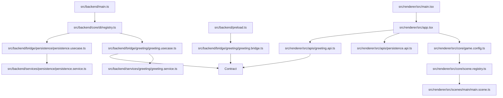
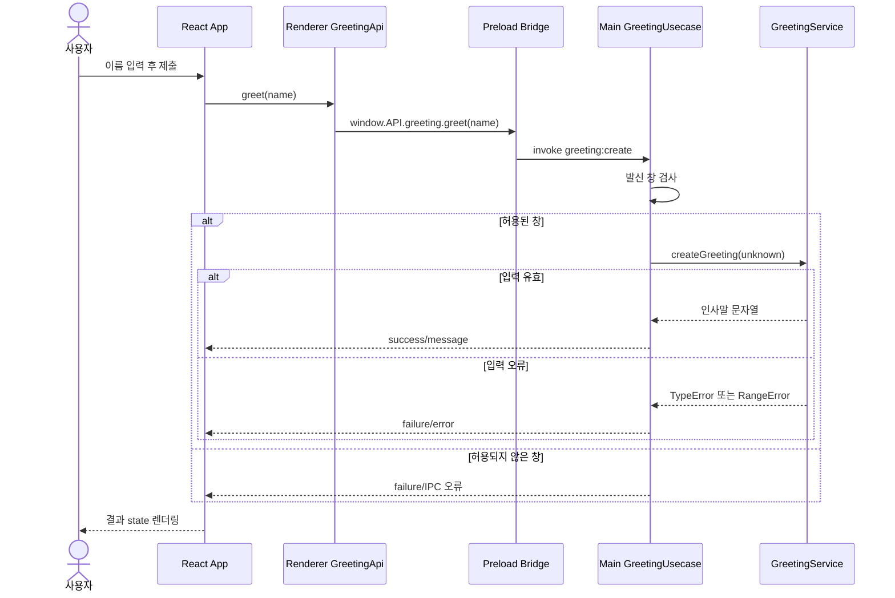

<!-- version: v1.0.3 -->
# 로컬 전용 Electron React 최소 보일러플레이트

## 1. 적용 범위

이 패키지는 다른 프로젝트에서 재사용할 Electron 앱 샘플입니다. React Renderer에서 플레이어 이름으로 연결 확인을 요청하고 Main이 검증해 인사말을 반환하는 한 기능을 구현합니다.

보일러플레이트 이름은 `electron-phaser`, 앱 유형은 `electron-app`, 실행 통신 프로필은 `local-only`입니다. 프로덕션 앱은 로컬 파일과 앱 내부 IPC로 동작합니다. 개발용 localhost Vite 서버와 패키지 설치 시 다운로드는 외부 업무 API 연동을 의미하지 않습니다.

외부 통신용 프로필은 별도 샘플로 관리합니다. 이 샘플은 HTTP 클라이언트, 원격 인증, 서버 오류 응답 계약, 타임아웃·재시도·취소, 연결 장애 및 자격증명 저장 정책을 제공하지 않습니다. 해당 기능이 필요한 프로젝트는 별도 프로필의 구현·검증 범위를 기준으로 시작해야 합니다.

게임은 파란 원 클릭으로 점수를 올리고 React 버튼으로 라운드를 재시작합니다. IPC 인사말 기능은 데스크톱 연결 확인 예제로 유지합니다.

## 2. 버전 기준

- 확인 환경: macOS 13 Ventura (`Darwin 22.6.0`), x86_64, Node.js `v24.22.1`, npm `11.19.1`.
- Phaser `4.2.1`이 게임 렌더링·입력을 담당합니다.
- 직접 의존성: Electron `45.1.0`, React/React DOM `19.1.1`, TypeScript `5.9.3`, Vite `6.4.5`, Vitest `5.0.5`, esbuild `0.25.12`, cross-env `7.0.3`.
- 앱 package 버전: `1.0.1`. Node 타입은 Electron 내장 Node와 개발 Node 24 기준의 `@types/node 24.19.2`입니다.
- React 타입 패키지: `@types/react 19.1.10`, `@types/react-dom 19.1.7`.
- 버전 기준 파일은 `boilerplates/minimal/.nvmrc`, `package.json`, `package-lock.json`입니다. 직접 의존성은 정확한 버전으로 고정합니다.

## 3. 폴더·파일명과 전체 직접 관리 파일 목록

| 샘플 기준 경로 | 폴더/파일 역할 및 처리 | 주요 내보내기·사용처 |
|---|---|---|
| `boilerplates/minimal/src/shared/ipc/persistence.ts` | GameSave 버전·score 검증과 저장 IPC 계약 / Main과 Renderer | 저장·리소스 흐름 |
| `boilerplates/minimal/src/backend/services/persistence/persistence.service.ts` | userData 고정 파일을 조회하고 순차 임시파일 쓰기 후 rename / PersistenceUsecase | 저장·리소스 흐름 |
| `boilerplates/minimal/src/backend/services/persistence/persistence.service.test.ts` | 초기값·재생성 후 복원·손상 및 음수 거부 / Vitest | 저장·리소스 흐름 |
| `boilerplates/minimal/src/backend/bridge/persistence/persistence.usecase.ts` | 발신 창 검사와 load/save 결과·오류 변환 / MainRegistry | 저장·리소스 흐름 |
| `boilerplates/minimal/src/backend/bridge/persistence/persistence.bridge.ts` | 허용된 load/save IPC 호출 / Preload | 저장·리소스 흐름 |
| `boilerplates/minimal/src/renderer/src/apis/persistence.api.ts` | 저장 IPC 오류 처리와 반환 데이터 검증 / React App | 저장·리소스 흐름 |
| `boilerplates/minimal/src/renderer/src/resource/assets.ts` | Vite asset URL과 Phaser 텍스처 키 관리 / LoadingScene·MainScene | 저장·리소스 흐름 |
| `boilerplates/minimal/src/renderer/src/resource/target.svg` | 원 타겟 이미지 원본 / Vite 및 Phaser loader | 저장·리소스 흐름 |
| `boilerplates/minimal/src/renderer/src/scenes/loading/loading.scene.ts` | 로딩 진행률·실패 표시 후 텍스처 존재 시 게임 진입 / createScenes | 저장·리소스 흐름 |
| `boilerplates/minimal/README.md` | 샘플 단독 복사 시 요구 런타임, 설치·실행·테스트·빌드·종료 안내 | 새 프로젝트 개발자 |
| `boilerplates/minimal/.gitignore` | 의존성, 빌드 결과, 로그, OS 파일을 Git에서 제외 | Git |
| `boilerplates/minimal/.nvmrc` | Node.js `24.22.1` 기준 | nvm |
| `boilerplates/minimal/package.json` | 앱 이름, Electron Main 진입 파일, 의존성, 실행·검사 명령 | npm/Electron |
| `boilerplates/minimal/package-lock.json` | 의존성 전체 해석 버전·무결성 잠금 | `npm ci` |
| `boilerplates/minimal/tsconfig.json` | React JSX 포함 Renderer/shared strict 검사 설정 | typecheck/Vite |
| `boilerplates/minimal/tsconfig.electron.json` | Main 및 Preload 관련 TS를 NodeNext JS로 컴파일 | `build:electron` |
| `boilerplates/minimal/vite.config.ts` | `src/renderer/src`를 Renderer 루트로, 상대경로 asset과 개발 포트를 지정 | Vite |
| `boilerplates/minimal/vitest.config.ts` | Vitest 검색 루트를 샘플 저장소로 고정하고 Node 환경을 지정 | `npm test` |
| `boilerplates/minimal/src/backend/main.ts` | Electron ready 이후 보안 옵션으로 창 생성, dev URL 또는 빌드 HTML 로드, Registry 초기화 | package `main` |
| `boilerplates/minimal/src/backend/preload.ts` | `contextBridge`로 `API.greeting`과 `API.persistence` 제공 | BrowserWindow preload |
| `boilerplates/minimal/src/backend/core/backend-module.ts` | IPC 모듈의 `setupHandlers(window)` 계약 | GreetingUsecase 구현 |
| `boilerplates/minimal/src/backend/core/di/registry.ts` | GreetingUsecase·PersistenceService·PersistenceUsecase를 생성·등록해 Main 조립 | `main.ts` |
| `boilerplates/minimal/src/backend/bridge/greeting/greeting.usecase.ts` | 채널 등록, WebContents 발신자 검사, 요청 검증 호출, 성공/오류 응답 생성 | Registry, Preload 채널 |
| `boilerplates/minimal/src/backend/bridge/greeting/greeting.bridge.ts` | `ipcRenderer.invoke`를 `GreetingBridge.greet`로 감싼다 | Preload |
| `boilerplates/minimal/src/backend/services/greeting/greeting.service.ts` | unknown 입력을 문자열/공백/길이 기준으로 검증하고 인사말 문자열 반환 | Usecase, 테스트 |
| `boilerplates/minimal/src/backend/services/greeting/greeting.service.test.ts` | 정상 공백 정리와 타입·빈 값·길이 오류 검증 | Vitest |
| `boilerplates/minimal/src/renderer/src/index.html` | React root와 TSX 진입점 선언 | Vite 입력 문서 |
| `boilerplates/minimal/src/renderer/src/main.tsx` | React root를 생성해 App 컴포넌트를 연결 | HTML 진입 스크립트 |
| `boilerplates/minimal/src/renderer/src/core/scene.registry.ts` | createScenes가 LoadingScene과 초기 점수·콜백을 받는 MainScene 배열을 조립 | createGameConfig |
| `boilerplates/minimal/src/renderer/src/core/game.config.ts` | 부모 DOM과 점수 콜백을 받아 640×360 FIT 설정과 씬 목록을 반환 | React App effect |
| `boilerplates/minimal/src/renderer/src/scenes/main/main.scene.ts` | 원 클릭 입력을 받아 점수를 증가시키고 위치를 바꾼 뒤 콜백 전달 | MainScene, createGameConfig |
| `boilerplates/minimal/src/renderer/src/app.tsx` | Phaser 수명주기, 점수·재시작 상태, IPC 결과를 화면에 표시 | `main.tsx`, GreetingApi |
| `boilerplates/minimal/src/renderer/src/style.css` | 폼·레이아웃의 기본 스타일 및 버튼 호버 | `main.tsx` import |
| `boilerplates/minimal/src/renderer/src/apis/greeting.api.ts` | `window.API.greeting` 존재를 확인하고 IPC bridge 호출 | React App |
| `boilerplates/minimal/src/renderer/src/apis/window.d.ts` | Renderer의 `window.API`에 shared bridge 타입 부여 | Renderer TS compiler |
| `boilerplates/minimal/src/shared/ipc/greeting.ts` | 채널 상수, 결과 union, `GreetingBridge`/`AppBridge` 계약 공유 | Usecase, bridge, Renderer |

직접 관리 목록은 위 표 전체입니다. `node_modules`, `dist`, `dist-electron`, 설치 캐시, 실행파일, vendor는 포함하지 않습니다.

영역 디렉터리는 소문자(`backend`, `renderer`, `shared`), 파일은 kebab-case와 역할 접미사(`.usecase.ts`, `.bridge.ts`, `.service.ts`, `.test.ts`), 클래스/인터페이스는 PascalCase, 채널 상수는 대문자 snake case입니다. Renderer 소스 위치는 `src/renderer/src/`입니다.

## 4. 아키텍처: 의존 방향과 대표 데이터 흐름

### 구성과 실행 경계

Electron Main은 `src/backend/main.ts`에서 실행되며 앱 수명, BrowserWindow, Preload 연결, IPC handler 등록을 소유합니다. Renderer는 Chromium 창 안에서 Vite가 제공하는 React UI를 실행하고 입력과 화면 상태를 소유합니다. Preload는 Main과 Renderer 사이의 제한된 bridge를 실행합니다. `src/shared/ipc/`는 양쪽 프로세스가 빌드 때 가져가는 계약 코드이며 별도 실행 프로세스나 서버가 아닙니다. 네트워크 서버나 DB는 없습니다.

### 폴더와 계층의 대응

| 실제 샘플 경로 | 계층/모듈 | 책임·공개 인터페이스 | 의존 대상 |
|---|---|---|---|
| `src/backend/main.ts` | Main 진입점 | Electron 준비 후 BrowserWindow 생성, Registry 초기화, Renderer 로드 | Electron, Registry |
| `src/backend/core/backend-module.ts` | Main 모듈 계약 | `BackendModule.setupHandlers(window)` | Electron BrowserWindow 타입 |
| `src/backend/core/di/registry.ts` | 조립/DI | `MainRegistry.initBackend(window)`에서 handler 모듈 등록 | GreetingUsecase |
| `src/backend/bridge/greeting/greeting.usecase.ts` | IPC 수신/응용 경계 | 채널 등록, 발신 WebContents 검사, 입력 검증 호출, 결과 반환 | Electron IPC, shared, Service |
| `src/backend/bridge/greeting/greeting.bridge.ts` | Preload 호출 어댑터 | `GreetingBridge.greet(name)`를 `ipcRenderer.invoke`에 연결 | Electron ipcRenderer, shared |
| `src/backend/services/greeting/greeting.service.ts` | 순수 기능 | `createGreeting(unknown)`이 이름을 정리·검증해 문자열 반환 | 표준 JS만 사용 |
| `src/backend/services/greeting/greeting.service.test.ts` | 단위 테스트 | 정상/오류 입력 기대 결과 검증 | Vitest, Service |
| `src/backend/preload.ts` | Preload 진입점 | `API.greeting`만 contextBridge로 공개 | greeting bridge |
| `src/shared/ipc/greeting.ts` | 프로세스 간 계약 | 채널명, 결과 union, bridge 인터페이스 | 타입/상수만 |
| `src/renderer/src/apis/greeting.api.ts` | Renderer API 어댑터 | `window.API` 유무 확인 뒤 `greet` 호출 | shared 계약, Preload 런타임 API |
| `src/renderer/src/app.tsx` | React 화면/상태 | Phaser 인스턴스 수명, 점수·재시작 및 IPC 결과 상태 관리 | React, Renderer API |
| `src/renderer/src/main.tsx`, `index.html`, `style.css` | React 진입/표현 | root mount, HTML 진입점, CSS 스타일 | React DOM, App, CSS |
| `vite.config.ts`, `tsconfig*.json`, `vitest.config.ts` | 빌드/검증 설정 | Renderer root/출력, TS 경계, 테스트 검색 루트 설정 | 개발 도구 |

### 게임 구조와 관리 규칙

`app.tsx`의 effect가 `new Phaser.Game(createGameConfig(parent, onScore))`를 호출하고 cleanup에서 `game.destroy(true)`로 캔버스와 엔진을 해제합니다. 재시작은 round state 변경으로 기존 게임을 제거하고 다시 생성합니다. React StrictMode의 재실행에서도 같은 해제 규칙을 따릅니다.

`game.config.ts`는 화면 크기·배경·scale과 Scene 조립을 소유합니다. `MainScene.create()`는 원과 클릭 리스너, 라운드 점수를 소유하고 콜백으로 React 표시를 갱신합니다. Scene은 React/Electron을 import하지 않습니다. 새 씬은 `*.scene.ts`, 순수 규칙은 `*.logic.ts`로 나누고 실제 필요할 때만 추가합니다. 이미지·오디오는 기능별 리소스 폴더에 두고 씬 preload에서 키로 등록합니다. 씬을 넘겨 유지할 데이터는 Scene 객체와 분리하며 영구 저장은 PersistenceApi와 Main 저장 서비스가 담당합니다.

씬 종료 때 외부 이벤트·타이머를 해제하고 공유 텍스처는 사용자가 남아 있는 동안 제거하지 않습니다. 프레임마다 React state를 갱신하지 않고 점수 등 UI 변화가 있을 때만 알립니다.

### 의존 규칙

#### Scene 기능별 파일 분리

각 기능은 `scenes/<기능>/` 안에서 책임에 따라 나눕니다. 모든 씬에 세 파일을 강제로 만들지 않고 계산 규칙이나 표시 코드가 커질 때 분리합니다.

| 파일 형식 | 책임 | 허용 의존과 반환값 |
|---|---|---|
| `<기능>.scene.ts` | Phaser 수명주기, 입력 연결, 의존성 주입, 로직과 표시 조립, 씬 전환·해제 | `.logic.ts`와 `.ui.ts`를 호출하고 결과를 연결 |
| `<기능>.logic.ts` | 상태 전이, 점수·보상 계산, 입력 규칙 등 게임 동작 결정 | 일반 TypeScript 데이터·리소스 정의를 받아 상태나 결과 반환. Phaser·React·DOM·Scene·UI에 의존하지 않음 |
| `<기능>.ui.ts` | Phaser 객체 생성·배치·갱신, 텍스트·효과·표시 전용 입력 콜백 연결 | Scene과 표시 데이터를 받아 표시 객체 또는 해제 함수를 반환. 저장·보상·게임 결과를 결정하지 않음 |

의존 방향은 `.scene.ts → .logic.ts`, `.scene.ts → .ui.ts`입니다. UI에서 게임 동작이 필요하면 전달받은 콜백을 호출하고 Scene이 로직을 수행합니다. logic에서 UI나 Scene을 역참조하지 않습니다. UI가 등록한 외부 리스너·타이머는 소유자가 명확히 해제하며, Scene 종료 시 관련 해제 함수를 호출합니다. Phaser 캔버스 UI의 `.ui.ts`와 React 화면 컴포넌트는 서로 다른 표시 계층입니다.

예를 들어 클릭 게임을 확장하면 `main.logic.ts`가 클릭 후 점수를 계산하고, `main.ui.ts`가 타겟 이미지 생성·위치 갱신을 맡으며, `main.scene.ts`가 클릭 콜백에서 두 작업을 연결합니다. 현재 최소 샘플은 동작이 작아 `main.scene.ts`에 있으며 `.logic.ts`·`.ui.ts` 파일은 아직 생성하지 않았습니다.

소스 import 방향은 Main `main.ts` → Registry → Usecase → Service, Preload `preload.ts` → Bridge, Renderer `main.tsx` → React App → Renderer API입니다. Main·Preload·Renderer 사이에는 `shared/ipc/greeting.ts` 계약만 공유합니다. Service는 Electron, React, IPC를 import하지 않습니다. Main은 React/Renderer를 import하지 않고 Renderer는 Electron 모듈을 import하지 않습니다. `shared`도 구현 계층에 의존하지 않습니다.

런타임 IPC는 소스 import와 별개입니다. Renderer API가 `window.API.greeting.greet()`를 호출하면 Preload의 `ipcRenderer.invoke('greeting:create', name)`가 Main Usecase로 요청을 전달합니다. Renderer가 Main 함수를 import하는 구조가 아닙니다.

### 진입·조립·수명주기

Electron 진입점은 `package.json`의 `main`인 `dist-electron/backend/main.js`입니다. `main.ts`는 `app.whenReady()`를 기다린 뒤 BrowserWindow를 만들고 `MainRegistry.initBackend(window)`를 호출합니다. Registry가 userData 경로의 PersistenceService를 PersistenceUsecase에 주입하고 GreetingUsecase와 함께 handler를 등록한 뒤 그 다음 개발 URL 또는 빌드된 HTML을 로드합니다. BrowserWindow가 창 수명을 소유하고, 이름과 결과 텍스트 상태는 React `useState`가 소유합니다. 별도 DB 설정, DI 컨테이너, 서버 상태는 없습니다.

시작 중 예외는 `start().catch`에서 기록하고 `app.quit()`로 종료합니다. `window-all-closed`도 앱 종료를 요청합니다. IPC handler 제거 코드는 없습니다. Main 종료와 함께 Electron이 정리하며, handler를 동적으로 재등록하는 앱으로 확장할 때 명시적인 해제 경로가 필요합니다.

### 정상·오류의 전체 흐름

1. `app.tsx`에서 사용자가 연결 확인을 요청하고 제출합니다. React는 처리 중 문구를 state에 표시합니다.
2. `GreetingApi.greet()`는 `window.API.greeting`이 존재하는지 확인한 뒤 bridge 함수를 호출합니다. 누락되면 예외입니다.
3. `greeting.bridge.ts`가 채널과 이름을 `ipcRenderer.invoke`로 전달합니다.
4. `greeting.usecase.ts`는 IPC 발신 `webContents.id`와 현재 창을 비교합니다. 불일치면 실패 결과를 반환합니다.
5. `greeting.service.ts`의 `createGreeting(unknown)`이 문자열 형식과 trim 후 1~40 길이를 검사합니다. 통과하면 인사말을 반환하고, 실패하면 TypeError/RangeError를 던집니다.
6. Usecase는 성공값을 `{ success: true, message }`로, 검증 예외를 `{ success: false, error }`로 바꿉니다. 응답은 invoke를 호출한 Renderer로 돌아갑니다.
7. React App은 성공/오류 문자열을 텍스트로 렌더링합니다. IPC Promise 거부나 bridge 누락은 통신 오류 문구로 표시합니다.

게임 시작 전 점수를 조회하고 저장 버튼으로 현재 점수를 파일에 기록합니다. 아래 저장 데이터와 리소스 수명주기에 전체 경로를 명시합니다.

### 구조도와 설계 선택

아래는 실제 소스 import 의존 구조입니다.



아래는 IPC 요청부터 React 상태 반영까지의 정상/오류 흐름입니다.



Main/Preload/shared를 분리해 프로세스 권한 경계를 드러내고, `core/di`에서 IPC 모듈을 조립합니다. 기능별 `bridge`와 순수 `services`를 나누어 입력 검증을 창 없이 테스트할 수 있습니다. React는 입력과 응답 상태를 소유합니다. 지원 범위는 단일 창, 로컬 저장 IPC와 연결 확인 IPC이며 동적 모듈 등록·배포 패키징은 포함하지 않습니다.

## 5. 기능 작성 규칙

1. 요청·응답 계약과 채널을 `src/shared/ipc/`에 먼저 선언합니다.
2. `src/backend/bridge/<기능>/`에 Usecase와 허용된 IPC 호출용 Bridge를 둡니다.
3. `src/backend/core/di/registry.ts`에서 Usecase를 등록하고 `backend-module.ts` 계약을 따릅니다.
4. 입력은 IPC 경계에서 `unknown`으로 받아 런타임 검증합니다. TypeScript 타입만으로 외부 입력을 신뢰하지 않습니다.
5. 순수 변환·검증은 `services/<기능>/<기능>.service.ts`에 두고 Vitest로 테스트합니다.
6. Preload는 필요한 함수만 `contextBridge`로 노출합니다. `ipcRenderer` 전체나 임의 채널 호출을 노출하지 않습니다.
7. Renderer API 계층이 `window.API`를 확인하고, React 컴포넌트는 사용자 입력 및 결과 상태를 표시합니다. 문자열 결과를 HTML로 삽입하지 않습니다.

예제는 문자열 1~40자(UTF-16 code unit)를 허용합니다. 글자소 단위 제한을 원하면 요구 UX에 맞게 검증기를 교체합니다.

새 기능 작성 예시는 이 `greeting` 흐름입니다. `shared/ipc/greeting.ts`에 계약을 두고, `greeting.bridge.ts`와 `greeting.usecase.ts`에서 IPC 경계를 연결하고, `greeting.service.ts` 및 테스트로 입력/출력을 검증한 뒤 `renderer/src/apis/greeting.api.ts`와 `app.tsx`를 통해 UI에 붙입니다.

### 규모 확장을 위한 구현 경계

아래 표는 현재 샘플과 확장 시 추가할 책임을 구분합니다. 확장 경로는 권장 배치이며 아직 생성되지 않은 파일을 실행 가능한 기능으로 취급하지 않습니다.

| 관심사 | 현재 구현 | 확장할 위치와 규칙 |
|---|---|---|
| 시작·조립 | React App이 저장 조회 후 Phaser 생성 | `core/scene.registry.ts`에서 공용 의존성을 한 번 생성해 필요한 씬에 주입. 씬마다 저장 API·Store를 새로 만들지 않음 |
| 게임 상태 | MainScene의 라운드 점수, React 표시 점수 | 실행 중 상태는 기능별 모델로 분리. React 표시값은 게임 상태의 투영이며 두 곳에서 독립 계산하지 않음 |
| 영구 상태 | version 1과 score를 파일에 저장 | `renderer/src/save/`에 모델·검증·Store를 추가해 저장 성공 후 메모리 확정. 현재 샘플에는 이 Store 계층이 없음 |
| 콘텐츠 정의 | `resource/assets.ts`와 target SVG | 공유 콘텐츠는 `resource/<종류>/models.ts`, 개별 정의, `index.ts` 등록. 한 기능 전용 정의는 `scenes/<기능>/resource/` |
| 계산 | 작은 클릭 규칙은 MainScene에 포함 | `scenes/<기능>/*.logic.ts`에 순수 입력→결과 계산을 분리. 여러 모드에서 같은 규칙을 재사용 |
| 화면 | React 제어 UI와 Phaser Scene | Canvas 객체는 `*.ui.ts`, 수명·전환은 `*.scene.ts`. UI 콜백은 의도를 전달하고 규칙 계산은 수행하지 않음 |
| 리소스 | LoadingScene에서 공용 타겟 1개 로드 | 씬별 필요한 asset 목록을 만들고 현재 소유자와 공용 여부를 확인한 뒤 불필요한 asset만 해제 |
| 설정 | 게임 설정은 core, 창 설정은 Main | 진행 데이터·그래픽/음량 설정·개발 설정을 구분. localStorage는 비밀정보를 담지 않는 로컬 표시 설정에만 사용 |

### 데이터 모델과 콘텐츠 등록

정적 정의, 영구 저장, 실행 중 상태를 구분합니다. 정적 정의에는 ID·기본 수치·리소스 키를, 영구 저장에는 ID와 사용자 변경값을, 실행 중 상태에는 현재 위치·체력·임시 효과를 둡니다. Phaser GameObject, 함수, Texture, Scene, DOM은 저장하지 않습니다.

예를 들어 적 콘텐츠를 추가할 때 `resource/enemy/models.ts`에 정의 타입을 만들고 `resource/enemy/<id>/<id>.ts`에서 정의합니다. `resource/enemy/index.ts`에 명시적으로 등록하며 ID 중복과 필수 asset 참조를 검사합니다. 이 경로들은 확장 예시이며 현재 샘플 파일 목록에 포함되지 않습니다. 파일명·ID는 소문자 kebab-case로 유지하고 대소문자에 민감한 OS에서도 경로가 일치하도록 합니다. 콘텐츠 등록, 리소스 등록, 씬 등록은 서로 별개입니다.

### 저장 확장과 버전 변경

현재 `parseGameSave`는 version 1만 허용하고 다른 버전·손상 데이터를 거부합니다. 자동 마이그레이션·암호화·백업 기능은 구현되어 있지 않습니다. 저장 필드를 확장할 때는 다음을 함께 구현합니다.

1. `GameSave` 타입·신규 게임 기본값·전체 검증기를 동시에 갱신합니다.
2. 이전 버전별 변환 함수를 순서대로 실행하고 변환 결과를 현재 검증기로 다시 검사합니다. 미래 버전은 덮어쓰지 않고 중단합니다.
3. 읽기 실패와 파일 없음은 구분합니다. 파일 없음만 기본값으로 시작하며 손상 파일의 초기화는 사용자의 명시적 동작으로 처리합니다.
4. 변경 요청은 복제한 draft에 적용하고 검증·영구 저장이 성공한 뒤 메모리 상태를 확정합니다. 저장 실패 시 진행 재화나 보상만 메모리에 반영되지 않도록 합니다.
5. 순차 저장 큐를 유지하고 실패 후 다음 요청이 계속 수행되는지 검사합니다. 현재 Main 서비스의 큐는 파일 쓰기만 직렬화하며 게임 상태 트랜잭션은 제공하지 않습니다.
6. 데이터에 콘텐츠 ID를 저장하면 존재 여부·중복·참조 관계까지 검사합니다. 구조 타입 검사만으로 무결성을 보장하지 않습니다.

현재 임시 파일 쓰기 후 rename은 정상 실행 중 덮어쓰기 위험을 줄이는 구현이며 전원 차단 시 완전한 내구성·다중 앱 프로세스 동시 쓰기를 보장하지 않습니다. 이를 요구하면 단일 인스턴스 정책, 백업/복구, 플랫폼별 저장 내구성을 별도로 설계합니다. 보상 지급과 체크포인트 갱신은 하나의 저장 변경으로 묶고 재실행 시 중복 지급되지 않게 완료 상태나 거래 ID를 함께 기록합니다.

### 씬 전환·세션·리소스 관리

`createScenes` 등록 후 실제 진입 버튼/전환 키를 명시적으로 연결합니다. `start`, `stop`, `sleep`, `wake`에 따라 객체와 상태의 존속이 다르므로 재진입 시 초기화할 값과 세션에 유지할 값을 정합니다. 외부 이벤트 구독·타이머·비동기 작업은 shutdown/destroy에서 해제하거나 무효화합니다. 종료된 씬의 지연 응답으로 새 화면을 갱신하지 않습니다.

리소스 전환은 필요한 키 수집 → 이미 로드된 키 재사용 → 누락분 로드 → 실패 여부 확인 → 화면 생성 → 이전 화면 소유 리소스 해제 순서로 확장합니다. 공유 텍스처·애니메이션은 사용 중인 다른 씬이 없는지 확인합니다. 텍스처를 사용하는 Sprite/Text가 살아 있는 상태에서 캐시를 제거하지 않습니다. 로더 진행 이벤트와 오류 이벤트는 등록 주체가 정리하고, 실패한 필수 리소스가 있으면 게임 진행을 막고 재시도 경로를 제공합니다. 현재 샘플의 실패 복구는 앱 재시작 방식입니다.

스프라이트 정의에는 모션별 파일 경로·frameWidth/frameHeight·frame 수·재생 속도·원점·방향을 실제 출력물과 일치시킵니다. 표시 배율과 충돌/사거리 반경은 별도 값으로 관리합니다. 프레임별 외곽 크기를 기준으로 자동 확대하면 동작 중 본체 크기가 바뀔 수 있으므로 공통 본체 비율을 유지합니다. 이미지 생성 스타일·픽셀 규격은 프로젝트 요구가 정해질 때 별도 규격으로 확정하고 임의의 제품 수치를 재사용하지 않습니다.

### 게임 계산·UI·성능·검증

전투나 시뮬레이션이 추가되면 논리 좌표와 화면 좌표를 구분하고, 시간 단위와 고정/가변 timestep 정책을 정합니다. 재현이 필요한 결과는 시드 난수를 입력으로 받아 계산하고 화면 연출의 난수와 분리합니다. 계산 결과는 이벤트/상태로 UI에 전달하며 Sprite 위치나 애니메이션 완료 여부를 게임 결과의 근거로 사용하지 않습니다.

매 프레임 React state를 갱신하지 않습니다. UI에 필요한 변경만 전달하고 핫패스의 반복 탐색·객체 생성·정렬은 실제 측정 후 최적화합니다. 화면 밖 UI 클릭, 스크롤 마스크, 입력 중복, 해상도 변경, 씬 재진입 및 StrictMode 이중 effect를 확인합니다. 저장·구매 등 비동기 동작은 처리 중 중복 실행 정책을 명확히 합니다.

테스트는 순수 logic의 경계값, 콘텐츠 ID/참조, 저장의 구버전·미래 버전·손상·쓰기 실패, 리소스 경로 및 씬 종료 후 이벤트를 우선합니다. 타입 검사와 빌드는 이미지 잘림·방향·GUI 배치·로딩 실패 화면을 검증하지 않으므로 실제 실행 점검을 별도로 남깁니다. 대규모 파일은 역할별 하위 logic/ui로 나누되 공통화는 두 사용처 이상의 실제 공통 책임이 확인될 때 수행합니다.

## 6. 정확한 명령과 실행 방법

모든 경로와 명령은 `boilerplates/minimal/`을 작업 루트로 합니다.

```bash
npm ci
npm test
npm run typecheck
npm run build
```

| 명령 | 동작 |
|---|---|
| `npm run dev` | Vite를 `127.0.0.1:5173`에서 실행 |
| `npm run build:renderer` | React Renderer를 `dist/renderer/`에 빌드 |
| `npm run build:electron` | Main/shared를 `dist-electron/`에 컴파일하고 Preload를 CommonJS 번들로 생성 |
| `npm run build` | Renderer와 Main/Preload 빌드 |
| `npm run electron:dev` | 빌드 후 Electron을 Vite 개발 URL에 연결 |
| `npm run electron:start` | 빌드 후 파일 기반 Renderer로 실행 |
| `npm test` | Vitest 실행 |
| `npm run typecheck` | Renderer와 Electron TS 프로젝트 모두 검사 |

개발은 터미널 1에서 `npm run dev`, 터미널 2에서 `npm run electron:dev` 순서로 실행합니다. Electron 창을 닫고 Vite 터미널에서 Ctrl+C를 누르면 종료됩니다. 포트 변경은 `vite.config.ts`와 `src/backend/main.ts`의 URL을 함께 수정합니다. `strictPort: true`라 포트 충돌 시 서버는 실패를 표시합니다.

## 7. 보안·변경 경계

- `contextIsolation: true`, `nodeIntegration: false`, `sandbox: true`를 유지합니다.
- IPC는 현재 BrowserWindow의 WebContents 요청만 받으며, 이름은 Main에서 타입·공백·길이를 검사합니다.
- 오류는 제한된 문자열 결과로 반환합니다. React 출력은 텍스트 렌더링입니다.
- 개발 URL은 localhost 고정이고 임의 원격 URL을 로드하지 않습니다.
- 패키징, 자동 업데이트, 코드 서명, DB, 외부 자격증명은 범위 밖입니다. 운영 기능에 추가할 때 별도 보안 검토가 필요합니다.

## 8. 새 프로젝트로 복사·치환

1. `boilerplates/minimal/`의 내용물을 새 프로젝트 루트에 복사합니다. 패키지 폴더 이름 자체를 내부 경로로 만들지 않습니다.
2. 이 문서의 형제 파일인 `project-agents.md`를 새 프로젝트 루트의 `AGENTS.md`로 복사합니다. 보관 중에는 자동 적용되지 않는 이름입니다.
3. 지침 내 `boilerplates/minimal/src/...` 링크를 새 루트 기준 `src/...`로 바꿉니다. `project-agents.md`의 `docs/boilerplate.md` 링크도 문서를 새 프로젝트에 복사하거나 상대 경로를 조정해야 유효합니다.
4. `package.json`의 name/version과 화면 이름, 기능을 변경하고 의존성 변경 후 `npm install`로 lockfile을 갱신합니다.
5. 계약 → Bridge/Usecase → Service/테스트 → Renderer API/React UI를 연동하고 전체 명령을 다시 확인합니다.

### 기능 하나를 끝까지 추가하는 작업 순서

1. 사용자 입력, 계산 결과, 영구 저장 여부, 리소스와 실패 경로를 먼저 적습니다.
2. 기존 계약·모델·헬퍼를 검색하고 공유 정의인지 기능 전용 정의인지 결정합니다.
3. 정적 콘텐츠와 ID/asset 등록을 작성하고 순수 logic의 입력·출력을 정의합니다.
4. 저장 필드가 필요하면 버전·기본값·검증·변환·실패 처리를 먼저 연결합니다.
5. Scene 생성 의존성을 registry에서 주입하고 UI 및 입력 콜백을 연결합니다.
6. 필요한 리소스를 진입 전에 로드하고 재진입·실패·종료 시 소유권을 확인합니다.
7. 저장 성공 이후 화면 확정, 중복 입력 방지, 돌아가기/재개 경로를 확인합니다.
8. 관련 테스트와 타입 검사·빌드·실제 UI 확인을 수행하고 파일표·아키텍처·지원 범위를 갱신합니다.

콘텐츠 제작 도구를 추가할 때에는 현재 타입을 기준으로 읽기·검증·출력을 수행하고 도구에서 생성한 TS도 동일한 타입/검사 경로를 통과하게 합니다. 편집용 원본과 런타임 산출물을 구분하고 미참조 여부만으로 원본을 삭제하지 않습니다. 개발 도구는 실제 반복 작업이 생긴 뒤 `scripts/`에 추가하며 이 샘플에는 아직 도구가 없습니다.

## 9. 예외·검증 결과

- 실제 확인 환경: macOS 13 Ventura (`Darwin 22.6.0`), x86_64, Node.js `v24.22.1`, npm `11.19.1`.
- 이 샘플에는 프로젝트 라이선스를 지정하지 않았습니다. 배포할 때 사용할 코드와 의존성의 라이선스·저작권 고지를 확인하고 필요한 고지를 유지하세요.
- package-lock 생성은 `npm install --package-lock-only --ignore-scripts --no-audit --no-fund`로 성공했습니다.
- 전체 유형 폴더를 임시 위치에 복사하고 그 안의 `boilerplates/minimal/`에서 `npm ci --no-audit --no-fund`를 실행했습니다. PATH에 Node 24.22.1을 우선 지정했을 때 설치가 성공했습니다.
- 복사본에서 `npm test` 통과(테스트 파일 1개, 2개 테스트), `npm run typecheck` 통과, `npm run build` 통과(Renderer Vite, Main TypeScript, Preload esbuild).
- 복사본의 `npm run electron:start`와 `npm run electron:dev`가 Electron 프로세스를 띄우는 것을 확인하고 Ctrl+C로 종료했습니다. UI 자동화 서비스는 연결되지 않아 폼 입력과 결과 문구의 시각·상호작용 검증은 미완료입니다.
- 초기 GUI 실행은 빌드 Renderer 경로 오류로 실패했습니다. `src/backend/main.ts` 경로를 수정해 재빌드한 후 프로세스 기동 및 종료가 정상 동작했습니다.
- 문서 링크·JSON·TS/Vite/Vitest 설정·package 스크립트와 파일명을 실제 파일과 대조했습니다. macOS 외 플랫폼, 코드 서명 및 패키징은 실행하지 않았습니다.

### 요구사항 대조표

| 요구사항 | 실제 파일·절 위치 | 검증 방법·결과 | 상태 |
|---|---|---|---|
| 갱신 이력 | update.md | 확인 가능한 커밋·버전·검증 결과 및 현재 문서 변경 기록 | 충족 |
| 유형 폴더에 목적 README·보관용 지침·상세 문서·샘플 | 유형 폴더 `README.md`, `project-agents.md`, `docs/boilerplate.md`, `boilerplates/minimal/` | 산출물 경로 및 파일 존재 대조 | 충족 |
| 샘플 전체 직접 관리 파일 역할 | 3절 직접 관리 파일 표 | 샘플 파일 트리와 표 대조 | 충족 |
| 폴더·파일 이름 규칙 | 3절 이름 규칙 | 실제 파일명 및 접미사 대조 | 충족 |
| 구성과 실행 경계 | 4절 `구성과 실행 경계` | Main/Renderer/Preload/shared의 실제 소유 코드 대조 | 충족 |
| 폴더와 계층의 대응 | 4절 계층 표 | 주요 인터페이스, 책임, 의존 파일 대조 | 충족 |
| 의존 규칙(import와 IPC 구분) | 4절 `의존 규칙` | 실제 import 및 invoke 채널 대조 | 충족 |
| 진입·조립·수명주기 | 4절 `진입·조립·수명주기` | Main 시작, Registry, 종료 코드 대조 | 충족 |
| 정상·오류 전체 흐름 | 4절 `정상·오류의 전체 흐름` | React/API/Preload/Usecase/Service 경로 대조 | 충족 |
| 구조도와 설계 선택 | 4절 `구조도와 설계 선택` Mermaid 2개 | 실제 경로·의존·오류 흐름 대조 | 충족 |
| 규모 확장·데이터·저장·리소스 관리 | 5절 확장 규칙과 8절 기능 추가 순서 | 구현/미구현 구분, 상태 소유권·실패·등록·해제 절차 확인 | 충족 |
| 새 기능 추가 예시 | 5절 및 8절 단계 | 샘플 API/service/UI 추가 위치와 순서 확인 | 충족 |
| 버전 관리 파일 | `.nvmrc`, `package.json`, `package-lock.json`, 2절 | npm lock 생성, package manifest·lock 의존성 확인 | 충족 |
| 독립 설치·테스트·빌드 | 샘플 README 및 9절 | 복사본 `npm ci`, 테스트 2개, 타입 검사, 빌드 통과 | 충족 |
| Electron 앱 기동·종료 | 샘플 README와 9절 | 복사본에서 `electron:start`·`electron:dev` 기동 후 Ctrl+C 종료 | 충족 |
| 문서 링크·설정 문법·명령 일치 | 문서 전체, package/lock, TS/Vite/Vitest 설정 | 로컬 링크·JSON 파싱·스크립트와 실제 파일명 대조 | 충족 |
| GUI 폼 입력·결과 표시 | React 화면과 IPC 호출 | UI 자동화 서비스 부재로 수동 입력/시각 결과 확인 불가 | 미검증 |
| CI·패키징·다른 OS/CPU | 1·2·7절 범위 | CI 및 패키징 설정 없음 | 해당 없음 — 요청된 최소 로컬 샘플 범위가 아님 |

게임 전환 검증: Phaser 의존성과 lockfile을 갱신했습니다. 이전 인사 폼 UI의 시각 검증 기록은 새 게임 UI 검증을 의미하지 않습니다. 원 클릭·점수 갱신·재시작 GUI는 미검증입니다.

게임 전환 후 독립 복사본 검증: `npm ci`, `npm run typecheck`, 기존 IPC 테스트 2개, `npm run build` 통과. Phaser 포함 번들의 500 kB 경고가 있으며 빌드는 성공했습니다. 이번 게임 UI의 실행·직접 조작은 미검증입니다.

씬 추가는 `scenes/<기능>/<기능>.scene.ts`에 구현하고 `core/scene.registry.ts`의 `createScenes`에 등록합니다. `core/game.config.ts`는 게임 설정만 반환하며 엔진 생성·해제는 React App의 effect가 담당합니다.

### 저장 데이터와 리소스 수명주기

앱 시작 → React App의 PersistenceApi.load → Preload persistenceBridge → PersistenceUsecase의 발신 창 검사 → PersistenceService.load → GameSave 검증 → React에 초기 점수 주입 → createGameConfig → LoadingScene.preload → MainScene 순서로 진행합니다. 파일이 없으면 version 1/score 0을 사용하고 손상·알 수 없는 버전은 오류로 표시하며 게임을 시작하지 않습니다. 실패 데이터를 자동 덮어쓰지 않습니다.

점수 저장 버튼 → PersistenceApi.save → Main 입력 검증 → 순차 저장 큐 → userData/save.json.tmp 쓰기 → save.json rename → 성공 응답 순서입니다. 저장은 명시적 버튼 방식이며 저장하지 않고 종료한 점수는 복원되지 않습니다. 저장 경로는 Main만 결정하고 Renderer는 경로를 입력할 수 없습니다. 암호화·클라우드 동기화는 포함하지 않습니다. 브라우저 단독 실행은 영구 저장 bridge가 없어 시작 오류를 표시합니다.

resource/assets.ts가 이미지 URL·텍스처 키를 소유합니다. LoadingScene이 진행률을 표시하며 공유 텍스처를 로드하고 성공 시 MainScene으로 전환합니다. 로딩 오류는 화면에 남기고 게임 진입을 막습니다. 현재 공유 리소스는 게임 인스턴스 전체 수명 동안 유지하고 React cleanup의 game.destroy(true)에서 해제합니다. 새 리소스는 resource에 추가하고 assets에 등록한 뒤 LoadingScene에서 로드합니다.

저장·리소스 추가 후 복사본 검증: 타입 검사, 테스트 3개(저장 복원·손상 데이터 거부 포함), Renderer/Main/Preload 빌드 통과. 실제 Electron 재시작 후 화면 점수 복원과 로딩 오류 화면은 GUI 미검증입니다. 저장 완료 표시를 확인한 뒤 종료해야 하며 앱 강제 종료 중 쓰기 완료는 보장하지 않습니다.

## 반입 검토 (2026-10-28)

현재 저장 기능 포함 버전의 유형 폴더 전체를 독립 임시 위치에 복사해 Node 24.22.1·npm 11.19.1로 `npm ci`, `npm test`(2개 파일·3개 테스트), `npm run typecheck`, `npm run build`를 통과했습니다. 문서 상대 링크·앵커·코드 펜스, JSON 문법, 전체 샘플 파일 역할 목록도 확인했습니다. 앞선 2개 테스트 기록은 저장 기능 추가 전 결과입니다.

이번 검토에서는 Electron 창 기동·게임 클릭·점수 저장 후 재실행을 확인하지 않았습니다. 서비스 단위 테스트 통과는 IPC 발신자 검증이나 실제 GUI 검증을 대신하지 않습니다. Phaser 포함 JS 번들은 약 1.88 MB(압축 약 443 kB)이며 Vite의 500 kB 경고가 발생하지만 빌드는 성공했습니다.

`npm audit`는 취약 패키지 5개(moderate 1, high 2, critical 2)를 보고했습니다. 대상은 Electron·Vite·Vitest·@vitest/mocker·tinypool입니다. 개발 의존성으로 분류된 Electron도 실제 앱 런타임이므로 개발 도구만의 문제로 판단하지 않습니다. [Vitest 공지](https://github.com/advisories/GHSA-82fw-gwwq-j7x9), [tinypool 공지](https://github.com/advisories/GHSA-85c8-ppgw-ccpr), [Electron 공지](https://github.com/advisories/GHSA-hq2x-r82h-9wj4), [Vite 공지](https://github.com/advisories/GHSA-rq7h-c2jc-7f22)를 참고하고 사용 전 버전 갱신·재검증이 필요합니다. 검토·반입 범위에서 manifest와 lockfile 버전은 변경하지 않았으며 `npm audit fix --force`도 실행하지 않았습니다.

저장은 단일 앱 프로세스 내부에서만 순차 처리됩니다. 같은 저장 파일을 사용하는 다중 앱 실행 간 충돌 방지는 구현되지 않았습니다. 설치 시 Electron·esbuild·fsevents의 install-script 승인 경고가 있었으며 GUI 바이너리 설치·실행 성공으로 해석하지 않습니다.

갱신 날짜·변경 이유·버전 전후·적용/복귀·검증 이력은 [update.md](../update.md)에서 관리합니다.

## 보안·버전 점검 (2026-10-29)

앱 package 버전은 1.0.1입니다. 독립 복사본에서 npm ci·테스트(3개)·타입 검사·빌드를 통과했고 전체 의존성 npm audit는 보고된 취약점 0건입니다. 이는 점검 시점의 알려진 npm 공지 기준이며 모든 보안 문제의 부재를 의미하지 않습니다. Electron 45.1.0·Vite 6.4.5·Vitest 5.0.5와 Node 타입 24.19.2를 사용합니다. Electron 45.1.0의 창 기동·종료, preload IPC 인사말, 임시 userData의 저장·조회, Phaser 캔버스 생성은 자동 점검했습니다. 직접 게임 클릭·앱 재실행 후 저장 복원·다른 OS는 미검증입니다. 버전 변경 이유·적용/복귀는 [update.md](../update.md)에서 관리합니다.
