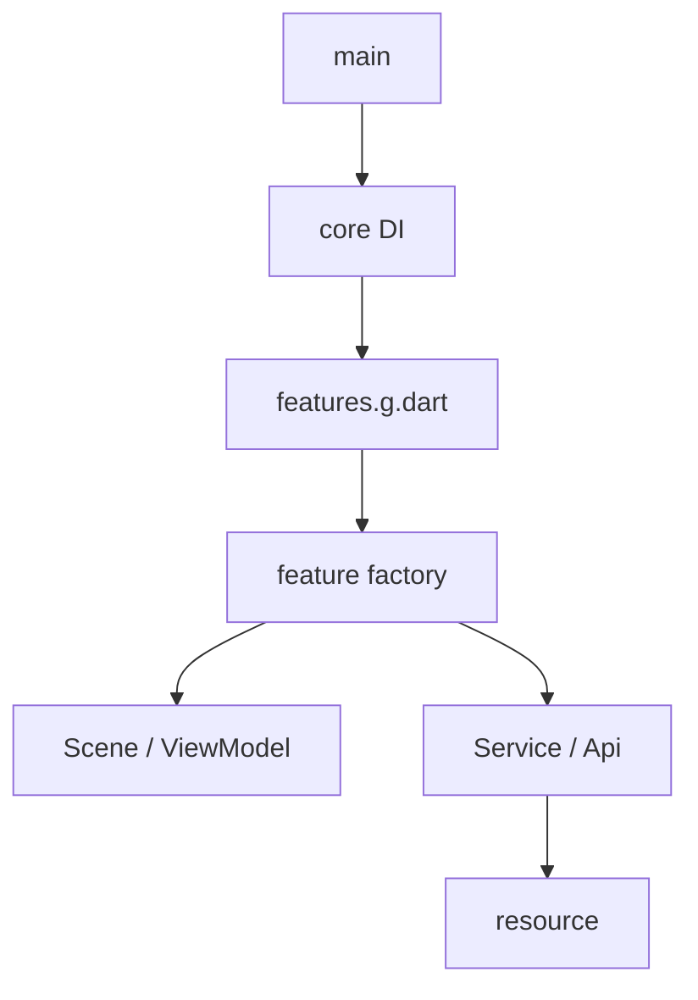
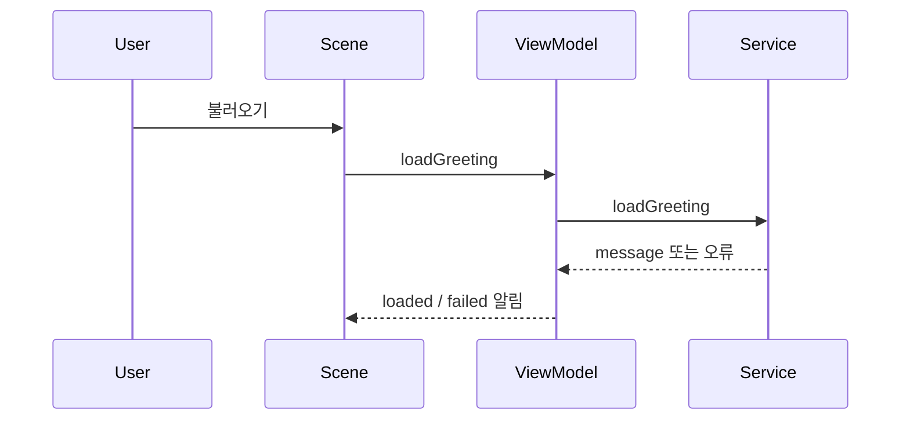

<!-- version: v8.0.0 -->
# Flutter 모바일 구조·개발 규칙

## 1. 적용 범위

Android·iOS·공용 앱의 공통 Flutter base입니다. feature 미선택 앱은 빈 시작 화면, 기능 추가 후에는 등록한 화면 목록을 표시합니다. 기존 인사 샘플은 greeting-resource로 분리했습니다. 원격 서버·인증·DB·제품 서명은 포함하지 않습니다. 앱 루트의 소스만 실행하며 원본 Composer를 import하지 않습니다.

## 2. 기술 스택과 버전 기준

.fvmrc의 Flutter 3.35.7 / Dart 3.9.2, pubspec.yaml·pubspec.lock을 사용합니다. Android는 JDK 17·AGP 8.11.1·Kotlin 2.2.20·Gradle 8.14·최소 API 28/compile·target 36을 유지합니다. iOS 최소 15.0이며 도구의 현재 제출 적합성은 배포 문서를 따릅니다. 기존 외부 검증 조합은 update.md에 보존하며 새 구조의 native 빌드 성공으로 간주하지 않습니다.

## 3. 폴더·파일과 역할

| 경로 | 역할·연결 |
| :--- | :--- |
| lib/main.dart | createAppDependencies를 만들어 MobileApp 시작 |
| lib/core/app.dart | feature 목록·화면 이동, 앱 종료 시 의존성 해제 |
| lib/core/app_dependencies.dart | 등록된 기능의 객체 목록과 소유권·dispose |
| lib/core/app_feature.dart | ID·화면 제목·Widget·해제 콜백 계약 |
| lib/core/features.g.dart | 스크립트 소유 import·factory 목록. 직접 수정하지 않음 |
| lib/scenes/기능명/ | Scene·ViewModel·Service·Model·feature 조립 factory; 선택 시 추가 |
| lib/apis/, lib/resource/ | 선택 기능의 데이터 접근·공개 번들 자산 |
| test/app_test.dart | feature 없는 앱 및 등록 목록의 기동 검사 |
| test/scenes/ | 선택 기능의 화면·상태·오류 검사 |
| scripts/feature.mjs | list/add 명령·잠금·FVM 검증·결과 보고 |
| scripts/composer-core.mjs | 파일·선언 검사, 생성 연결/asset 계획, 충돌·복구 |
| .composer/features/ | 반출한 기능 원본·버전·사용 문서. 런타임 import 대상 아님 |
| .composer/state.json | target/base·원본 스냅샷·활성 기능 ID/버전·관리 구간·생성 해시 |
| package.json, .nvmrc | 의존성 없는 Node 조립 명령·도구 버전 |
| pubspec.yaml, pubspec.lock, analysis_options.yaml | 앱 버전·정확한 pub 의존성·분석 규칙·선택 feature asset 등록 |
| .fvmrc, .metadata | 고정 Flutter·선택 플랫폼의 Flutter migration 기록 |
| .env.example, .gitignore | 비밀값 없는 환경 양식·개인 설정/캐시 제외 |
| android/ | 선택 시 포함. Gradle Wrapper·AGP/Kotlin·앱 ID·SDK·권한·리소스 |
| ios/, Gemfile | 선택 시 포함. Xcode 프로젝트·Bundle ID·권한·배포 대상·Ruby gem 요구 |
| docs/, README.md, project-agents.md, AGENTS.md, update.md | 설치·개발·배포·지침·실제 변경/검증 |

뼈대 원본에만 compose.mjs와 test/composer/*.test.mjs가 있습니다. 생성 앱은 실행에 필요한 feature 도구만 포함합니다. 외부 구성품의 files는 활성화 시 앱 루트에 추가됩니다.

## 4. 의존 방향과 데이터 흐름

### 구성과 실행 경계

Flutter 앱이 화면·상태를 소유합니다. Android/iOS는 플랫폼 호스트이며 Node는 개발 시 조립 도구입니다. .composer는 재현용 데이터이고 모바일 런타임에 포함하도록 asset에 등록하지 않습니다.

### 폴더와 계층의 대응

| 경로 | 책임 | 의존 대상 |
| :--- | :--- | :--- |
| core | 앱 시작·DI·수명 | 기능 factory·공통 계약 |
| scenes | 표현·상태·기능 흐름 | 주입된 Service 계약 |
| apis | 번들·외부 데이터 경계 | Flutter 서비스/플랫폼 API |
| resource | 공개 번들 데이터 | 비밀·개인 환경을 넣지 않음 |

### 의존 규칙

Scene은 주입된 ViewModel을 사용하며 API 구현을 직접 만들지 않습니다. Service는 위젯을 import하지 않습니다. feature factory가 Service·API·ViewModel을 조립하고 AppFeature를 반환합니다. 기능끼리 상대 import를 추가할 때는 선행 계약과 버전 지원을 먼저 정의합니다.

### 진입·조립·수명주기

main → createAppDependencies → createFeatures → feature factory 순서로 생성합니다. 앱 루트가 기능 ViewModel을 소유하고 dispose합니다. 화면을 닫아도 앱 소유 상태는 유지합니다. 비동기 완료 후 dispose된 객체가 notifyListeners하지 않게 처리합니다. 소켓/구독/네이티브 객체를 추가하면 같은 소유 경계의 해제 콜백에 연결합니다.

### 정상·오류의 전체 흐름

greeting-resource 선택 시 Scene 버튼 → ViewModel → GreetingService → GreetingApi → 번들 JSON → message 검증 → loaded 상태/화면으로 흐릅니다. 잘못된 JSON·값·I/O 오류는 안전한 실패 메시지로 표시합니다. counter는 화면 → increment → 상태 변경·알림만 수행하며 불필요한 Service를 만들지 않습니다.

### 구조도와 설계 선택

첫 그림은 소스 의존, 둘째는 호출 흐름입니다. 최소 MVVM과 DI로 상태·I/O 테스트를 분리합니다.

## 5. 기능 작성 방식

제품 전용 코드는 lib/scenes/기능명과 대응 test에 작성합니다. 재사용 feature 제작은 Composer 관리자 작업이며 앱의 catalog에 파일만 넣어 우회하지 않습니다. 공개 계약·구현 버전·지원 target·권한·패키지·등록 factory·검증을 함께 정의합니다.

생성 등록 파일과 pubspec의 composer:assets 구간은 스크립트 소유입니다. 사용자 화면은 별도 파일에 작성합니다. 사용자 asset과 생성 asset의 통합 정책은 현재 자동 지원하지 않으며 외부 assets 목록이 충돌하면 중단합니다. 새로운 요구가 생기면 파서/병합과 회귀 검사를 먼저 확장합니다.

## 6. 설치·실행·검증

환경 설치는 [시작](./01-getting-started.md), 실행·feature 명령은 [README](../README.md)를 따릅니다. 앱 루트에서 fvm flutter analyze·test, 선택 플랫폼의 빌드·기기 동작을 확인합니다. 생성/모의 명령 검사를 앱 실행으로 표시하지 않습니다.

## 7. 보안·변경 경계

외부 입력은 데이터 경계에서 검사하고 내부 예외·비밀값을 화면에 노출하지 않습니다. 실제 .env·키·서명·local.properties·Pods·캐시를 공유하지 않습니다. 새로운 권한은 Android Manifest/iOS Info.plist·런타임 동의·거부/재시도·스토어 고지까지 별도로 검토합니다. 현재 두 feature는 추가 권한·외부 pub 패키지가 없습니다.

## 8. 새 프로젝트로 복사·치환

앱은 이미 Composer에서 생성한 위치를 루트로 사용합니다. 폴더명을 바꿔도 상대 링크는 유지됩니다. Dart package 이름은 생성 때 반영되며 Android applicationId·namespace·iOS Bundle Identifier·제품 표시 이름·서명은 [배포](./06-build-and-release.md) 기준으로 바꿉니다. 이미 개발한 앱을 다시 compose로 덮어쓰지 않습니다.

## 9. 예외·검증 결과

구조 전환 후 실제 검사 결과는 update.md를 확인합니다. 이전 위치에서의 정상 버전 조합은 역사적 근거이며 현재 OS/스토어 지원 보장이 아닙니다. GUI·실기기·네이티브 빌드·스토어는 실제 수행 여부를 구분합니다. Mermaid는 원문 문법만 관리하며 렌더링 미확인은 별도로 기록합니다.

## 플랫폼별 권한·패키지·버전 업데이트

Android는 SDK·Gradle·AGP·Kotlin·JDK와 앱 권한, iOS는 Xcode·SDK·배포 대상·Ruby/CocoaPods와 동의 문구를 구분해 관리합니다. [Android](./03-android-build.md)·[iOS](./04-ios-build.md)·[버전 관리](./07-version-management.md)를 읽고 pubspec/lock·native 설정·지원 OS·실제 검사·데이터 복귀를 함께 갱신합니다. lock 삭제나 전역 도구 일괄 갱신으로 오류를 숨기지 않습니다.
