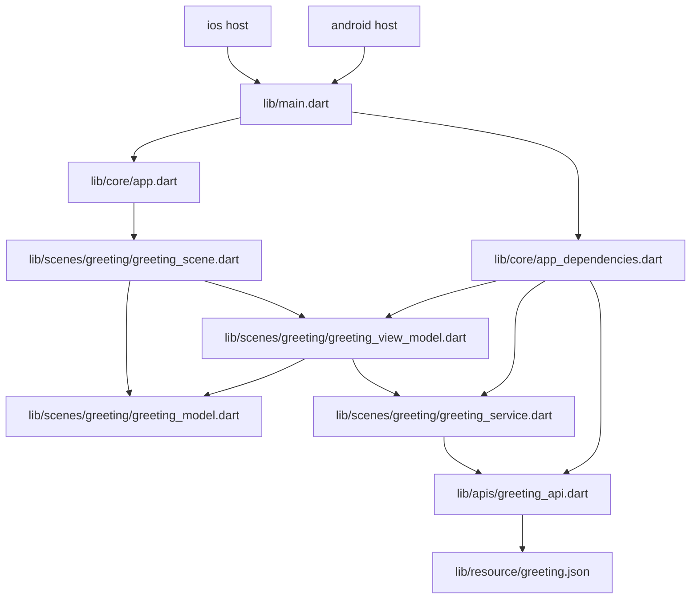
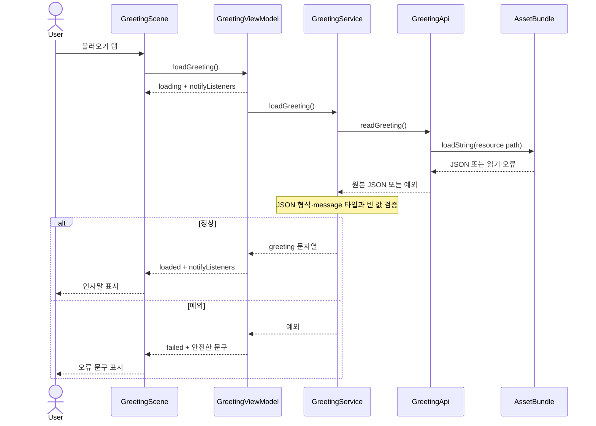

<!-- version: v4.1.0 -->
# 1. 적용 범위

Flutter로 Android·iOS 모바일 화면을 시작하는 최소 샘플이다. 로컬 인사말 하나를 버튼으로 불러 화면에 표시하며, 화면(View)·상태(ViewModel)·데이터 접근 계약(Service)·생성자 주입(DI)의 연결을 보여준다. 네트워크·DB·라우팅·인증·제품 도메인 기능은 없다. 실행 샘플과 문서의 루트는 이 패키지 폴더다.

# 2. 기술 스택과 버전 기준

| 항목 | 값·기준 파일 |
| :--- | :--- |
| Flutter | `.fvmrc`: 3.35.7 |
| Dart | `pubspec.yaml`: `^3.9.2`; Flutter 3.35.7에 포함된 Dart 3.9.2 |
| 앱 버전 | `pubspec.yaml`: 1.0.0+1 |
| SDK·직접 의존성 | `pubspec.yaml`: Flutter SDK, 개발용 `flutter_lints: ^5.0.0` |
| 정확한 의존성 해석 | `pubspec.lock`, Flutter Pub이 생성 |
| Android | AGP 8.11.1·Kotlin Plugin 2.2.20·Gradle 8.14, min/compile/target API 28/36/36, NDK 27.0.12077973 |
| iOS | Runner Deployment Target 15.0; macOS·Xcode 필요 |

샘플의 Android·iOS 프로젝트 파일은 Flutter 3.35.7 CLI로 생성했다. 앱 이름·버전은 Flutter SDK 버전과 다르다. 앱 의존성을 바꿀 때 manifest와 Flutter가 생성한 lockfile을 함께 검토한다. [Flutter 프로젝트 생성](https://docs.flutter.dev/reference/create-new-app), [FVM 프로젝트 버전 선택](https://fvm.app/documentation/guides/basic-commands).

# 3. 폴더·파일명과 전체 역할 목록

## 명명 규칙

Dart 소스는 `snake_case.dart`, 타입은 `UpperCamelCase`, 멤버는 `lowerCamelCase`를 쓴다. `core/`에 앱·DI를 두고 `scenes/<scene>/`에 Scene·Model·ViewModel·Service를 나란히 둔다. 외부/네이티브 통신이 생기면 저수준 연결을 `apis/`로 분리한다. 이름은 역할을 나타내며 화면 파일은 `_scene.dart`, 상태 파일은 `_view_model.dart`, 데이터 계약은 `_service.dart` 접미사를 사용한다. Android의 Kotlin·Gradle·리소스와 iOS의 Xcode 파일은 Flutter 생성 템플릿의 이름을 유지한다.

## 직접 관리 파일

아래 목록은 Git에 포함할 샘플 직접 관리 파일이다. `android/local.properties`, `ios/Flutter/Generated.xcconfig`, `ios/Flutter/ephemeral/`, `.idea/`, `.dart_tool/`, `build/`, `android/app/src/main/java/io/flutter/plugins/GeneratedPluginRegistrant.java`, `ios/Runner/GeneratedPluginRegistrant.*`는 로컬 생성 설정·산출물로 제외한다.

| 경로(샘플 루트 기준) | 역할·주요 구성 | 연결·검증 |
| :--- | :--- | :--- |
| `.fvmrc` | 프로젝트 Flutter SDK 3.35.7 선택 | FVM install/use가 읽고 SDK 링크를 준비 |
| `Gemfile` | CocoaPods 1.16.2 고정 | 프로젝트 루트에서 Bundler로 설치·실행; 최초 생성한 Gemfile.lock도 Git 보관 |
| `.gitignore` | FVM 링크·Dart/Flutter 캐시·빌드·개인 설정 제외 | Git 보존 경계 |
| `.metadata` | Flutter 프로젝트 생성 정보·플랫폼 목록 | Flutter CLI의 프로젝트 관리 |
| `README.md` | 선행 조건·복원·검사·실행·종료 안내 | 독립 샘플 시작점 |
| `analysis_options.yaml` | `flutter_lints` 권장 규칙 포함 | `fvm flutter analyze` |
| `.env.example` | 비밀값 없는 환경 변수 양식. 실제 `.env`는 Git 제외 | 프로젝트 환경 준비 |
| `pubspec.yaml` | 앱 이름·버전·Dart 범위·Flutter/lint 의존성 | Pub 복원·앱 package 이름 |
| `pubspec.lock` | Flutter Pub이 해석한 정확한 의존 트리 | `fvm flutter pub get`, 테스트 |
| `lib/apis/greeting_api.dart` | `GreetingApi`가 주입된 AssetBundle로 문자열을 읽음 | Service에 원본 JSON 전달 |
| `lib/resource/greeting.json` | message 문자열을 담은 번들 자산 | pubspec.yaml의 assets에 등록 |
| `test/scenes/greeting/greeting_service_test.dart` | 자산 경로·JSON 형식·message 검증 | 정상 값과 잘못된 값 검사 |
| `lib/main.dart` | `main()`에서 조립 함수 호출 후 앱 실행 | 앱 진입점; DI에 연결 |
| `lib/core/app.dart` | `MaterialApp`·theme·첫 화면 조립; 앱 종료 때 DI 자원을 dispose | main의 `MobileApp`; View로 전달 |
| `lib/core/app_dependencies.dart` | `AppDependencies`, `createAppDependencies`; 기본 구현 생성·생성자 주입·수명 종료 | main과 테스트에서 사용 |
| `lib/scenes/greeting/greeting_service.dart` | `GreetingService` 계약과 `AssetGreetingService` 로컬 JSON 읽기·message 검증 구현 | ViewModel이 계약에만 의존 |
| `lib/scenes/greeting/greeting_model.dart` | `GreetingStatus` 대기·진행·성공·실패 상태 정의 | Scene·ViewModel·테스트에서 사용 |
| `lib/scenes/greeting/greeting_view_model.dart` | `GreetingViewModel`; 대기/성공/실패 상태·중복 실행 방지·오류 메시지 공개 | View의 명령·단위 테스트 |
| `lib/scenes/greeting/greeting_scene.dart` | `GreetingScene`; 상태별 텍스트와 버튼 활성화를 렌더링하고 탭을 ViewModel에 전달 | `MobileApp`에서 주입; 위젯 테스트 |
| `test/scenes/greeting/greeting_view_model_test.dart` | 성공·실패 상태와 오류 상세 비노출 테스트 | ViewModel과 fake Service |
| `test/scenes/greeting/greeting_scene_test.dart` | 버튼 탭 후 인사말 표시 위젯 테스트 | DI·앱·ViewModel·View 연결 |
| `android/.gitignore` | Android 로컬 SDK·IDE·빌드·서명 설정 제외 | Android 전용 비밀·기계별 설정 보호 |
| `android/settings.gradle.kts` | Flutter Gradle plugin loader·AGP 8.11.1·Kotlin 2.2.20 선언 | root Gradle 구성 |
| `android/build.gradle.kts` | 저장소·하위 프로젝트 빌드 디렉터리·clean 작업 | Android app 빌드 |
| `android/gradle.properties` | AndroidX·Jetifier 및 Gradle JVM 옵션 | Gradle 구성 |
| `android/gradle/wrapper/gradle-wrapper.properties` | Gradle 8.14 배포판 URL·캐시 설정 | 버전이 고정된 wrapper |
| `android/gradle/wrapper/gradle-wrapper.jar` | Gradle wrapper 실행기 | `gradlew`의 Java 진입부 |
| `android/gradlew` | macOS/Linux Gradle wrapper 시작 스크립트 | Flutter Android 빌드에서 호출 |
| `android/gradlew.bat` | Windows Gradle wrapper 시작 스크립트 | Flutter Android 빌드에서 호출 |
| `android/app/build.gradle.kts` | 앱 플러그인·namespace/applicationId·min/compile/target API·NDK·빌드 타입 | Flutter plugin이 Android 앱 구성 |
| `android/app/src/debug/AndroidManifest.xml` | debug 전용 Android manifest 설정 | Debug 빌드 |
| `android/app/src/profile/AndroidManifest.xml` | profile 전용 Android manifest 설정 | Profile 빌드 |
| `android/app/src/main/AndroidManifest.xml` | 앱 라벨·런처 Activity 등 Android 진입 설정 | MainActivity와 앱 아이콘 참조 |
| `android/app/src/main/kotlin/com/example/mobile_app_sample/MainActivity.kt` | Flutter `FlutterActivity` 진입점과 Kotlin package | Android manifest가 실행 |
| `android/app/src/main/res/drawable/launch_background.xml` | 기본 Android 시작 배경 | Android 첫 화면 초기 표시 |
| `android/app/src/main/res/drawable-v21/launch_background.xml` | API 21 이상 시작 배경 | Android 첫 화면 초기 표시 |
| `android/app/src/main/res/mipmap-mdpi/ic_launcher.png` | Android mdpi 런처 아이콘 | Main manifest의 app icon |
| `android/app/src/main/res/mipmap-hdpi/ic_launcher.png` | Android hdpi 런처 아이콘 | Main manifest의 app icon |
| `android/app/src/main/res/mipmap-xhdpi/ic_launcher.png` | Android xhdpi 런처 아이콘 | Main manifest의 app icon |
| `android/app/src/main/res/mipmap-xxhdpi/ic_launcher.png` | Android xxhdpi 런처 아이콘 | Main manifest의 app icon |
| `android/app/src/main/res/mipmap-xxxhdpi/ic_launcher.png` | Android xxxhdpi 런처 아이콘 | Main manifest의 app icon |
| `android/app/src/main/res/values/styles.xml` | 기본 Android launch theme | Android 시작 화면 |
| `android/app/src/main/res/values-night/styles.xml` | 야간 Android launch theme | Android 시작 화면 |
| `ios/.gitignore` | Xcode·CocoaPods·Flutter 생성 설정·서명 파일 제외 | iOS 로컬 상태 보호 |
| `ios/Flutter/AppFrameworkInfo.plist` | Flutter framework의 iOS metadata | Runner Xcode 프로젝트 |
| `ios/Flutter/Debug.xcconfig` | debug Flutter build 설정 포함 | Debug scheme |
| `ios/Flutter/Release.xcconfig` | release Flutter build 설정 포함 | Release scheme |
| `ios/Runner.xcodeproj/project.pbxproj` | Runner target·iOS 15.0 Deployment Target·빌드 설정·파일 참조 | Xcode 프로젝트·workspace |
| `ios/Runner.xcodeproj/project.xcworkspace/contents.xcworkspacedata` | Xcode 프로젝트 내부 workspace 선언 | Runner.xcodeproj |
| `ios/Runner.xcodeproj/project.xcworkspace/xcshareddata/IDEWorkspaceChecks.plist` | Xcode workspace 검사 설정 | 프로젝트 workspace |
| `ios/Runner.xcodeproj/project.xcworkspace/xcshareddata/WorkspaceSettings.xcsettings` | Xcode workspace 편집기 설정 | 프로젝트 workspace |
| `ios/Runner.xcodeproj/xcshareddata/xcschemes/Runner.xcscheme` | Runner 실행·테스트·빌드 scheme | Xcode 실행 구성 |
| `ios/Runner.xcworkspace/contents.xcworkspacedata` | CocoaPods 통합에 쓰는 Runner workspace 선언 | iOS 앱 개발·빌드 진입 |
| `ios/Runner.xcworkspace/xcshareddata/IDEWorkspaceChecks.plist` | Runner workspace 검사 설정 | Runner.xcworkspace |
| `ios/Runner.xcworkspace/xcshareddata/WorkspaceSettings.xcsettings` | Runner workspace 편집기 설정 | Runner.xcworkspace |
| `ios/Runner/AppDelegate.swift` | iOS 앱 delegate·Flutter 기본 플러그인 등록 진입 | Runner target |
| `ios/Runner/Info.plist` | iOS 표시 이름·지원 orientation·앱 설정 | Runner target |
| `ios/Runner/Runner-Bridging-Header.h` | Swift와 Objective-C bridging 선언 | Runner target |
| `ios/Runner/Base.lproj/Main.storyboard` | 기본 iOS FlutterViewController storyboard | Runner 시작 화면 |
| `ios/Runner/Base.lproj/LaunchScreen.storyboard` | iOS 시작 화면 storyboard | iOS 시작 화면 |
| `ios/Runner/Assets.xcassets/AppIcon.appiconset/Contents.json` | iOS app icon 크기·파일 매핑 | AppIcon 리소스 카탈로그 |
| `ios/Runner/Assets.xcassets/AppIcon.appiconset/Icon-App-1024x1024@1x.png` | iOS 1024px 앱 아이콘 | AppIcon 카탈로그 |
| `ios/Runner/Assets.xcassets/AppIcon.appiconset/Icon-App-20x20@1x.png`, `Icon-App-20x20@2x.png`, `Icon-App-20x20@3x.png` | iOS 20pt 앱 아이콘 크기별 파일 | AppIcon 카탈로그 |
| `ios/Runner/Assets.xcassets/AppIcon.appiconset/Icon-App-29x29@1x.png`, `Icon-App-29x29@2x.png`, `Icon-App-29x29@3x.png` | iOS 29pt 앱 아이콘 크기별 파일 | AppIcon 카탈로그 |
| `ios/Runner/Assets.xcassets/AppIcon.appiconset/Icon-App-40x40@1x.png`, `Icon-App-40x40@2x.png`, `Icon-App-40x40@3x.png` | iOS 40pt 앱 아이콘 크기별 파일 | AppIcon 카탈로그 |
| `ios/Runner/Assets.xcassets/AppIcon.appiconset/Icon-App-60x60@2x.png`, `Icon-App-60x60@3x.png` | iOS 60pt 앱 아이콘 크기별 파일 | AppIcon 카탈로그 |
| `ios/Runner/Assets.xcassets/AppIcon.appiconset/Icon-App-76x76@1x.png`, `Icon-App-76x76@2x.png` | iPad 76pt 앱 아이콘 크기별 파일 | AppIcon 카탈로그 |
| `ios/Runner/Assets.xcassets/AppIcon.appiconset/Icon-App-83.5x83.5@2x.png` | iPad 83.5pt 앱 아이콘 | AppIcon 카탈로그 |
| `ios/Runner/Assets.xcassets/LaunchImage.imageset/Contents.json` | iOS launch image 크기·파일 매핑 | LaunchImage 카탈로그 |
| `ios/Runner/Assets.xcassets/LaunchImage.imageset/LaunchImage.png`, `LaunchImage@2x.png`, `LaunchImage@3x.png` | iOS 시작 이미지의 배율별 파일 | LaunchImage 카탈로그 |
| `ios/Runner/Assets.xcassets/LaunchImage.imageset/README.md` | LaunchImage 리소스 안내 | LaunchImage 카탈로그 |
| `ios/RunnerTests/RunnerTests.swift` | 기본 iOS Runner XCTest host test | Xcode RunnerTests target |

Android/iOS native 파일은 Flutter 3.35.7의 플랫폼 템플릿이다. `gradlew`, `gradlew.bat`, `gradle-wrapper.jar`는 독립 복사 후 Android Gradle 실행에 필요해 저장한다. 플러그인 등록 파일·local.properties·Xcode generated config는 Flutter가 생성하므로 소스 패키지에 넣지 않는다.

# 4. 아키텍처와 대표 데이터 흐름

## 구성과 실행 경계

Android/iOS host가 Flutter 엔진과 `main()`을 시작한다. Dart 앱은 `MaterialApp`·View·ViewModel을 소유하고, ViewModel은 주입된 Service 계약에 요청한다. 현재 Service 구현은 번들 JSON을 읽고 message를 검증하므로 네트워크·운영 데이터·별도 저장소는 없다. 플랫폼 디렉터리는 Flutter 앱을 Android·iOS host에서 실행시키는 생성 경계다.

## 폴더와 계층의 대응

| 실제 경로 | 역할·공개 구성 | import·호출 대상 |
| :--- | :--- | :--- |
| `lib/main.dart` | `main()` 실행 시작 | `createAppDependencies`, `MobileApp` |
| `lib/core/app_dependencies.dart` | `AppDependencies`, `createAppDependencies()` 생성자 주입 | Service 계약·구현, ViewModel |
| `lib/core/app.dart` | `MobileApp`, MaterialApp과 첫 View 연결; 앱 수명 종료 때 dependencies dispose | DI 객체·GreetingScene |
| `lib/scenes/greeting/greeting_scene.dart` | `GreetingScene`, 화면 표시와 사용자 입력 | `GreetingViewModel` |
| `lib/scenes/greeting/greeting_view_model.dart` | `GreetingViewModel`, UI 상태·명령 | `GreetingService` 추상 계약 |
| `lib/scenes/greeting/greeting_service.dart` | `GreetingService`, 로컬 `AssetGreetingService` 구현 | Flutter UI에 의존하지 않음 |
| `test/scenes/greeting/` | fake Service·상태/위젯 테스트 | 앱의 공개 동작 검증 |
| `android/`, `ios/` | 각 host의 Flutter 실행·빌드 설정 | Flutter Gradle plugin·Xcode 프로젝트 |

## 의존 규칙

- 허용 소스 의존: 시작 코드→DI→기능 구현, App→View, View→ViewModel, ViewModel→Service 추상 계약.
- Service·데이터 코드는 화면·ViewModel·Material UI를 import하지 않는다. View는 Service 구현이나 DI 전역 생성자를 호출하지 않는다.
- 테스트는 fake Service를 주입할 수 있지만 테스트 도구를 앱 실행 코드가 import하지 않는다.
- 샘플에는 HTTP·IPC·파일 저장 등 런타임 통신이 없다. Dart import 관계와 Service의 함수 호출을 네트워크 경로처럼 설명하지 않는다.

## 진입·조립·수명주기

`lib/main.dart`의 `main()`이 `createAppDependencies()`를 호출한 뒤 `MobileApp`을 `runApp`에 전달한다. DI는 기본 로컬 Service와 ViewModel을 생성한다. `MobileApp`은 앱 루트에서 조립된 객체를 사용하고 StatefulWidget 종료 때 `AppDependencies.dispose()`로 ChangeNotifier를 해제한다. View는 ViewModel을 생성하거나 소유하지 않는다. 자산 읽기는 버튼 요청 때 시작하며 읽기·파싱 실패는 ViewModel의 오류 상태로 전달한다.

## 정상·오류의 전체 흐름

정상: `GreetingScene`의 버튼 → `GreetingViewModel.loadGreeting()` → `GreetingService.loadGreeting()` → `AssetGreetingService`가 GreetingApi로 번들 JSON을 읽고 검증한 문자열을 반환 → ViewModel이 loaded 상태와 greeting을 보관하고 notify → `AnimatedBuilder`가 View를 갱신한다. 요청 중 버튼은 비활성화되고 추가 호출은 무시한다.

오류: 자산 읽기·JSON 검증 또는 fake Service가 예외를 던지면 ViewModel은 failed 상태와 일반 오류 문구를 보관하고 notify한다. 원 예외·내부 상세를 화면에 전달하지 않는다. 실제 번들의 정상 경로와 잘못된 JSON·message 검증은 API·Service 테스트로, 안전한 화면 오류는 ViewModel fake로 검사한다.

## 구조도와 설계 선택

아래 화살표는 **Dart 소스 의존·객체 주입**이다.



아래 화살표는 **화면 동작·상태 알림의 런타임 호출 순서**다.



DI·View·ViewModel·Service만으로 작은 앱 흐름을 보이기 위해 상태관리·DI 라이브러리나 Repository 계층을 추가하지 않았다. 외부 데이터·캐시·여러 화면이 생기면 그 필요에 맞춰 계약과 계층을 확장한다. 구조는 Flutter [앱 아키텍처 가이드](https://docs.flutter.dev/app-architecture/guide)의 View/ViewModel/Data 분리를 참고하되, 이 샘플에 없는 구성 요소는 만들지 않았다.

## 리소스·API 예시

`lib/resource/greeting.json`은 앱과 함께 배포하는 공개 데이터입니다. `pubspec.yaml`의 `flutter.assets`에 등록하며 비밀값·변경 가능한 사용자 데이터를 넣지 않습니다. 자산 추가 후 Pub 복원·재빌드로 번들에 반영합니다.

DI가 `rootBundle`을 GreetingApi에 주입하고 API는 문자열 읽기만 맡습니다. AssetGreetingService가 JSON과 비어 있지 않은 message를 검증하고 ViewModel은 실패를 기존 오류 상태로 바꿉니다. 파일 누락·잘못된 JSON·message 오류를 기본값으로 숨기지 않습니다. 테스트는 메모리 AssetBundle과 실제 번들을 각각 사용합니다. 원격 HTTP 요청·네이티브 채널 예시는 아닙니다.

[Flutter 자산 등록·읽기](https://docs.flutter.dev/ui/assets/assets-and-images) · [AssetBundle.loadString](https://api.flutter.dev/flutter/services/AssetBundle/loadString.html).

# 5. 기능 작성 방식

1. 화면 요구와 상태(초기·진행·성공·실패)를 정한다.
2. 화면별 `scenes/<scene>/<scene>_view_model.dart`에서 상태·동작을 만든다. Service·Model은 같은 scene 폴더에 두고 외부 연결만 `apis/`로 분리한다.
3. `scenes/<scene>/<scene>_scene.dart`는 ViewModel을 받아 렌더링하고 동작을 전달한다. 비즈니스·I/O를 넣지 않는다.
4. `core/app_dependencies.dart`가 의존 객체를 생성·주입하고 수명 해제를 맡는다.
5. `test/scenes/<scene>/`에 ViewModel 상태 테스트와 사용자 입력을 포함하는 위젯 테스트를 추가한다.
6. `fvm flutter analyze`, `fvm flutter test`와 필요한 플랫폼 실행을 하고 이 설명서의 파일·흐름·검증표를 갱신한다.

# 6. 설치·실행·검증

모든 명령은 `pubspec.yaml`이 있는 mobile-app 프로젝트 루트에서 실행한다.

```sh
fvm install
fvm flutter --version
fvm flutter pub get
fvm flutter analyze
fvm flutter test
fvm flutter devices
fvm flutter run -d 기기ID
```

기기 ID는 마지막 명령 출력값으로 바꾼다. 성공 시 화면 제목은 `인사 샘플`, 초기 문구는 `버튼을 눌러 인사를 불러오세요.`, 버튼은 `불러오기`, 완료 후 문구는 `안녕하세요, Flutter!`다. 실패 경로는 테스트 fake가 `인사를 불러오지 못했습니다.`를 표시하는지 검사한다. 실행은 Ctrl+C로 종료한다.

Android debug APK는 `fvm flutter build apk --debug`로 만든다. Android SDK·Build-Tools·JDK 17이 필요하다. iOS 실행·빌드는 macOS·Xcode·서명·기기 설정이 필요하다. 샘플 생성 당시의 AGP·Gradle 조합은 JDK 25와 호환 경고가 있었고, 이후 사용자가 다른 작업 위치에서 확인한 Android·iOS 버전으로 프로젝트 설정을 갱신했다. 현재 저장소 사본의 Android APK·Xcode 빌드는 실행하지 않았다. GUI·실기기 성공으로 정적 테스트를 대신하지 않는다.

## 플랫폼별 권한·패키지·버전 업데이트

프로젝트별 버전 파일·개인 환경·실행 범위는 [환경 정의·격리](./02-project-environment.md)를 따른다. 프로젝트 빌드 환경의 설치·버전 선택·복귀는 [Android 빌드 관리](./03-android-build.md)와 [iOS 빌드 관리](./04-ios-build.md)를 따른다. 아래 절은 앱 권한·패키지·플랫폼 설정의 책임을 설명한다.

### 권한을 추가할 때

현재 로컬 인사 샘플에는 카메라·위치·마이크 같은 보호 자원 권한이 없다. 기능이나 플러그인을 추가할 때 아래 항목을 해당 기능 설명과 함께 기록한다. 패키지 설치만으로 권한 설정과 사용자 동의가 끝나는 것은 아니다.

| 플랫폼 | 설정 위치와 기록할 내용 | 확인할 동작 |
| :--- | :--- | :--- |
| Android | `android/app/src/main/AndroidManifest.xml`의 실제 필요한 permission, 지원 OS별 runtime 요청, 플러그인이 병합하는 manifest. debug/profile manifest와 release 최종 병합 manifest를 구분 | 최초 허용·거부·재요청·설정에서 철회 후 복귀; 권한 없는 상태에서도 가능한 기능 유지 |
| iOS | `ios/Runner/Info.plist`의 자원별 UsageDescription과 구체적인 사용 이유. 기능이 요구하면 Xcode Signing & Capabilities·entitlements도 기록 | 최초 동의·거부·설정에서 변경·복귀; 권한 종류별 제한 상태 확인 |

기능 문서에는 권한명/Info.plist 키, 필요한 이유, 적용 OS 범위, 요청 시점, 거부 시 화면 동작, 사용 플러그인과 검증 기기를 남긴다. 플러그인의 공식 플랫폼 설정과 SDK의 개인정보 manifest 요구도 확인한다. 선언 파일에 키를 추가하는 것과 런타임 권한 요청은 별도 작업이다.

공식 근거: [Android 권한](https://developer.android.com/guide/topics/permissions/overview), [Apple 보호 자원 접근](https://developer.apple.com/documentation/uikit/requesting-access-to-protected-resources).

### 버전의 기준 파일

| 구분 | 기준 파일·기록할 값 |
| :--- | :--- |
| 공통 SDK·Dart 패키지 | `.fvmrc`, `pubspec.yaml`, `pubspec.lock`; 선택 Flutter/Dart와 직접·간접 의존성의 실제 해석 버전 |
| 앱 배포 버전 | `pubspec.yaml`의 `version: 이름+빌드번호`; Android versionName/versionCode와 iOS CFBundleShortVersionString/CFBundleVersion 결과 확인. CI의 build-name/build-number 인자가 있으면 함께 기록 |
| Android | `android/app/build.gradle.kts`의 minSdk/compileSdk/targetSdk/NDK, `android/settings.gradle.kts`의 AGP/Kotlin, wrapper properties의 Gradle, 실제 Gradle JDK. 플랫폼 플러그인이 가져오는 Maven 의존성도 필요 시 Gradle dependency 보고서로 확인 |
| iOS | Xcode 버전·iOS deployment target·Bundle Identifier와 서명 설정. CocoaPods를 도입했다면 Podfile·Podfile.lock, Swift Package Manager를 사용한다면 해당 프로젝트의 Package.resolved·패키지 선언에서 실제 native SDK 버전 확인 |

현재 샘플에는 Podfile·Podfile.lock·Package.resolved가 없다. 존재하지 않는 파일을 버전 기준으로 만들거나 플러그인 추가 없이 네이티브 패키지 관리자를 도입하지 않는다. 앱마다 사용한 패키지 관리자와 잠금 파일을 확인한다.

### 업데이트·검증·복귀 순서

1. 변경 전 Git 상태와 정상 빌드 커밋, `.fvmrc`, manifest/lock, Android 도구 조합, Xcode·iOS 기준을 기록한다. 영구 저장 형식 변경이 있으면 데이터 백업·구버전 호환성을 먼저 정한다.
2. Flutter SDK 변경, Dart 패키지 변경, Android/iOS 네이티브 도구 변경을 한 번에 섞지 않는다. 샘플 루트에서 `fvm flutter pub outdated`로 확인하고 목표 패키지의 공식 changelog·Flutter/Dart 최소 조건·각 플랫폼 설정 변경을 읽는다.
3. 목표 패키지만 `fvm flutter pub upgrade 패키지명`으로 갱신한다. 제약 범위를 바꿔야 하면 pubspec을 검토해 수정한 뒤 Pub으로 lockfile을 생성한다. CocoaPods/SPM 의존성이 바뀌면 해당 관리자의 공식 절차로 선택한 SDK만 갱신하고 native lock 차이를 확인한다. 잠금 파일 삭제로 전체 갱신을 강제하지 않는다.
4. Android target API 요구와 OS 동작 변경, iOS 제출 시 Xcode/SDK 요구를 각 스토어 공식 페이지에서 확인한다. Flutter 고정 버전과 Android targetSdk는 별도 값이며, targetSdk 숫자 변경만으로 빌드·정책·동작 호환성이 검증되지는 않는다.
5. `fvm flutter analyze`, `fvm flutter test` 후 Android release AAB와 iOS 서명 빌드·archive를 필요한 환경에서 확인한다. 권한 허용/거부/철회, 플러그인 기능, 기존 설치본 위 업데이트와 데이터 보존을 실제 기기에서 검증한다. 내부 테스트 배포 결과도 기록한다.
6. `update.md`에 이유·앱/SDK/패키지/네이티브 도구의 변경 전후·변경 권한·검증 기기와 결과·미검증·복귀 방법을 남긴다. 실패하면 정상 커밋의 코드·manifest/lock·네이티브 설정을 함께 복원하고 같은 SDK로 의존성을 복원한다. 이미 배포한 앱은 스토어 빌드번호를 재사용하지 않고 새 번호로 수정 배포하며, 데이터 마이그레이션은 별도 복구 계획을 따른다.

공식 참고: [Flutter 패키지 관리](https://docs.flutter.dev/packages-and-plugins/using-packages), [의존성 갱신](https://docs.flutter.dev/packages-and-plugins/dependency-management), [Google Play target API](https://developer.android.com/google/play/requirements/target-sdk), [App Store 제출 요구](https://developer.apple.com/news/upcoming-requirements/).

# 7. 보안·변경 경계

- 기본 Service는 번들 JSON의 message를 검증해 반환한다. 원격 통신·인증·영구 저장·권한이 없으므로 이를 추가했다면 새로운 신뢰 경계와 검증을 설계한다.
- 사용자 표시 오류에는 예외 상세를 포함하지 않는다. 비밀값·서명 키·개인 SDK 경로를 코드·공유 설정·로그에 넣지 않는다.
- Android `applicationId`·`namespace`, Kotlin package, iOS `PRODUCT_BUNDLE_IDENTIFIER`와 표시 이름은 제품 고유 값으로 바꾼다. 앱 서명·스토어 배포는 범위 밖이다.
- Flutter 생성 아이콘·시작 화면 리소스는 샘플 템플릿 자산이다. 제품 브랜딩으로 교체하고 플랫폼 자산의 라이선스·고지를 확인한다. Flutter SDK는 [BSD 라이선스](https://github.com/flutter/flutter/blob/3.35.7/LICENSE)를 포함한다.
- `.fvm/`, `.dart_tool/`, `build/`, `.idea/`, Android `local.properties`, Xcode 생성 환경 파일·서명 파일은 추적하지 않는다.

# 8. 새 프로젝트로 복사·치환

이 패키지 루트가 Flutter 프로젝트 루트이자 문서 루트다. 새 앱은 [루트 README의 가져오기](../README.md#3-프로젝트-가져오기)에 있는 Git archive로 mobile-app 폴더 전체를 내보낸다. `.env.example`은 공유하고 실제 `.env`는 복사·추적하지 않는다. 문서 링크는 그대로 사용하며 파일 역할 표의 경로는 실행 루트 기준이다.

FVM에서 읽은 `.fvmrc`가 3.35.7을 설치·선택하는지 `fvm flutter --version`으로 확인한다. VS Code는 새 루트를 열고 Flutter 확장 SDK가 `.fvm/flutter_sdk`를 사용하는지 확인한다. `dart.flutterSdkPath`를 팀과 공유하면 기기별 경로가 아닌 프로젝트 상대 경로를 사용한다. IDE가 심볼릭 링크를 해석하면 SDK 표시 버전을 직접 다시 확인한다.

프로젝트 이름을 바꿀 때는 `pubspec.yaml`의 패키지 이름과 테스트의 `package:mobile_app_sample/...` import를 함께 바꾼다. Android 앱 ID를 바꿀 때는 `android/app/build.gradle.kts`, `MainActivity.kt` package·경로를 맞춘다. iOS Bundle Identifier·표시 이름은 `ios/Runner.xcodeproj/project.pbxproj`, `ios/Runner/Info.plist`에서 바꾼다. `project-agents.md`를 새 루트 `AGENTS.md`로 복사한다. 시작 가이드의 표준 배치를 유지하면 문서 링크를 수정할 필요가 없다.

코드 개발은 VS Code에서 진행하고 Android Studio는 가상 기기 생성·관리에 사용한다. 이 패키지는 새 경로에 복사해 시작하므로 기존 Flutter 프로젝트를 새 프로젝트 마법사로 덮어쓰지 않는다.

# 9. 예외·검증 결과와 요구사항 대조표

## 검증 환경·한계

- 2026-11-04 resource·apis 추가 후 임시 복사본에서 오프라인 Pub 복원, 정적 분석(No issues found), 테스트 6개를 통과했다. 실제 번들 읽기와 API·Service의 JSON·message 검증을 포함한다.

- 2026-11-04 core·scenes 구조 변경 후 임시 독립 복사본에서 Flutter 3.35.7로 오프라인 Pub 복원, 정적 분석(No issues found), 테스트 3개 통과를 확인했다. 앱의 네이티브 빌드·실기기 실행은 수행하지 않았다.

- 확인일 2026-11-02. macOS 13.7.8 x86_64, Flutter 3.35.7, Dart 3.9.2, Android Studio 설치본의 JBR 25.0.4. 아래 실행 검사는 당시 Android 설정에 대한 기록이다.
- 공식 Flutter CLI로 Android/iOS 샘플 프로젝트를 만들었다. 공식 archive 다운로드 MD5는 응답 `x-goog-hash` 값과 일치했다. Pub 의존성은 임시 캐시의 기존 패키지만 사용해 `flutter pub get --offline`을 수행했다.
- 샘플에서 `flutter test --no-pub`: **3개 통과**(ViewModel 성공·오류, 버튼 동작 위젯). `flutter analyze`: **No issues found**.
- Android 프로젝트 생성 시 Flutter가 Gradle 8.12에 감지 JDK 25가 맞지 않을 수 있다고 경고했다. Android Studio GUI, 에뮬레이터·실기기, iOS/Xcode 빌드와 다른 OS/CPU도 당시 미검증이었다.
- 2026-11-04에 사용자가 제공한 별도 작업 위치의 정상 동작 확인값(Flutter 3.35.7, AGP 8.11.1, Kotlin 2.2.20, Gradle 8.14, JDK 17, Xcode 15.2 등)에 맞춰 Android 설정·iOS 최소 대상 버전을 갱신했다. 이 저장소 사본에서 네이티브 빌드를 반복하지 않았다. Xcode 15.2는 현재 App Store 제출 SDK 요건을 충족하지 않는다.
- Mermaid 관계는 소스와 대조했으나 렌더러 시각 검증은 하지 않았다. pubspec 문법·lock 일관성은 Flutter Pub 복원으로 확인했다. 사용자 PC에 Flutter/FVM을 설치하지 않고 SDK는 임시 경로에서만 사용했다.

## 요구사항 대조표

상태는 문서·파일 존재와 실행 검증을 나눠 기록한다.

| 요구사항 | 실제 파일·절 위치 | 검증 방법·결과 | 상태 |
| :--- | :--- | :--- | :--- |
| 패키지 README | `README.md` 1~9절 | 목적·기술·복사·IDE·기능 추가·검증 안내 | 충족 |
| 작업 지침 보관본 | `project-agents.md` 1~6절 | 샘플 루트·실제 경계·명령을 코드와 대조 | 충족 |
| 상세 설명서 | `docs/05-boilerplate.md` 1~9절 | 필수 절과 이 대조표 포함 | 충족 |
| 갱신 이력 | `update.md` | 실제 생성·버전·변경·검증·미검증 기록 | 충족 |
| 독립 실행 샘플 | mobile-app 프로젝트 루트 | Flutter 생성 플랫폼 파일·소스·lock·테스트 확인 | 충족 |
| 직접 관리 파일 역할 | 설명서 3절 표 | Git에 포함할 Android/iOS·Dart·설정·lock·테스트 경로를 실제 트리와 대조 | 충족 |
| 명명 규칙 | 설명서 3절 | Dart 역할 접미사·대소문자·Flutter 생성 파일명 확인 | 충족 |
| 구성과 실행 경계 | 설명서 4절 해당 소제목 | Android/iOS host, Dart 앱, 로컬 Service 범위 대조 | 충족 |
| 폴더와 계층의 대응 | 설명서 4절 해당 소제목 | lib·test 실제 파일·export·의존을 표로 확인 | 충족 |
| 의존 규칙 | 설명서 4절 해당 소제목 | UI→ViewModel→Service·DI 조립 import 확인 | 충족 |
| 진입·조립·수명주기 | 설명서 4절 해당 소제목 | main·DI·MobileApp.dispose·ChangeNotifier 대조 | 충족 |
| 정상·오류 전체 흐름 | 설명서 4절 해당 소제목 | View→ViewModel→Service→상태→화면·fake 예외 검사 | 충족 |
| 구조도와 설계 선택 | 설명서 4절 해당 소제목 | Mermaid 의존·시퀀스 원문을 코드와 대조 | 충족 |
| Mermaid 실제 렌더링 | 설명서 4절 두 도식 | 렌더러로 표시 확인 안 함 | 미검증 |
| 새 기능 추가 | README 5절·설명서 5절 | greeting 구조에 맞춰 위치·조립·테스트 순서 대조 | 충족 |
| 버전·의존 관리 | `.fvmrc`, `pubspec.yaml`, `pubspec.lock`, 설명서 2·6절 | Flutter 3.35.7 pub 복원 후 분석·테스트 통과 | 충족 |
| 독립 복사·의존 복원 | 샘플 README·설명서 8절 | 유형 폴더 임시 복사본에서 `flutter pub get --offline` 통과 | 충족 |
| FVM `.fvmrc` SDK 선택 | `.fvmrc`·샘플 README | JSON 구조·버전 문자열 확인; FVM 실행 자체는 이 작업에서 미검증 | 미검증 |
| 상태·위젯 테스트 | 샘플 `test/` | 독립 복사본 `flutter test --no-pub`, 리소스·API 포함 6개 통과 | 충족 |
| 정적 분석 | `analysis_options.yaml`, `pubspec.yaml` | 독립 복사본 `flutter analyze`, No issues | 충족 |
| 앱 실행·종료 | 샘플 README 3절 | Android/iOS 기기·시뮬레이터를 실행하지 않아 앱 구동과 Ctrl+C 종료 미검증 | 미검증 |
| Android APK 빌드·실기기 | `android/`, 샘플 README | 별도 작업 위치에서 주신 조합 정상 확인; 이 저장소 사본 빌드 미실행 | 이 사본 미검증 |
| iOS 빌드·기기 | `ios/`, 샘플 README | 별도 작업 위치의 Xcode 15.2 조합 확인; 이 저장소 사본 빌드 미실행, 현재 스토어 제출은 Xcode 26 필요 | 이 사본 미검증 |
| 실제 IDE GUI | README 4절 | Android Studio·VS Code를 열어 확인 안 함 | 미검증 |
| 링크·코드 블록·설정 문법 | 유형 Markdown·샘플 JSON/XML/YAML | Markdown 8개 상대 링크·앵커·펜스 통과; JSON 3개·plist·XML 파싱, Flutter Pub YAML/lock 복원 통과 | 충족 |

## 독립 복사본 실행 기록

- 유형 폴더 전체를 `/private/tmp/mobile-app-package-check`로 복사했다. 이 임시 복사본의 샘플 루트에서 `flutter pub get --offline`, `flutter test --no-pub`(3개), `flutter analyze`를 실행해 모두 통과했다. Flutter SDK·Pub cache는 임시 경로를 사용했고 샘플은 상위 저장소 파일 없이 복원됐다.
- 당시 샘플에서 Git에 포함할 76개 파일 경로가 3절 역할 표에 모두 기록됐는지 대조했다. JSON 3개, XML·plist 설정 파일 파싱, Flutter Pub manifest/lock 복원이 통과했다. Mermaid 도식 원문을 코드 관계와 대조했으며 실제 렌더링은 미검증이다.
- Flutter 생성 파일·local.properties·빌드·`.dart_tool` 결과는 Git에 포함되지 않게 정리했다. Android Studio·VS Code GUI, Android APK/기기 실행·종료, iOS/Xcode 빌드는 실행하지 않았다.

## 라이선스

Flutter 템플릿으로 생성한 플랫폼 코드와 기본 런처/시작 이미지 외에 외부 소스 코드를 복사하지 않았다. Flutter SDK의 [BSD 라이선스](https://github.com/flutter/flutter/blob/3.35.7/LICENSE)와 lockfile의 Pub 패키지 라이선스는 제품 재배포 전 각 라이선스 정보를 확인한다.
