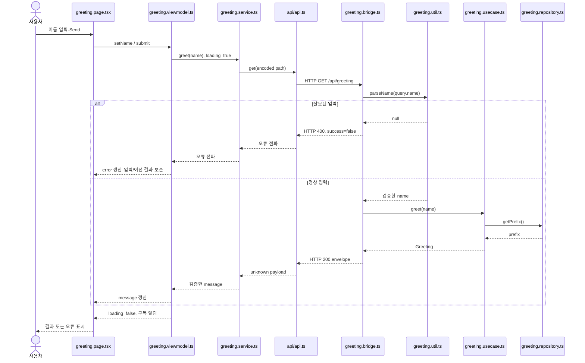

<!-- version: v1.1.1 -->
# 1. 적용 범위

이 패키지는 server-wui 유형의 독립 실행 샘플이다. [진입 README](../README.md), [작업 지침 보관본](../project-agents.md), [샘플 실행 안내](../boilerplates/minimal/README.md)가 함께 포함된다.

이번 문서 갱신은 이 패키지의 소스·설정·테스트를 기준으로 수행했다. 현재 포함된 기능은 이름 조회의 정상·오류 흐름, 파일 기반 공개 config 읽기·검증, 상태 구독과 입력 보존이다. 이를 모두 역할 목록·아키텍처·샘플 지침에 반영한다.

# 2. 버전 기준

모든 아래 경로는 **샘플 루트 `boilerplates/minimal/` 기준**이다. 본문의 문서 링크만 설명서 위치에서 계산한다.

| 기준 파일 | 내용과 책임 |
| --- | --- |
| `package.json` | 샘플 버전 1.0.0, ESM, Node >=24.22.1 <25, 실제 scripts와 정확한 직접 패키지 버전 |
| `package-lock.json` | npm이 생성한 전체 의존 트리·무결성·플랫폼별 선택 의존성. 손으로 작성하지 않음 |
| `.nvmrc` | 개발 Node 24.22.1 |
| `tsconfig.json` | ES2022·NodeNext·strict·react-jsx, 기본 noEmit |
| `server/tsconfig.json` | 서버 JS 출력만 dist/server로 생성 |
| `webui/vite.config.ts` | WUI 개발·프록시·dist/webui 빌드 |

Express 5.2.1, React/React DOM 19.3.0, TypeScript 7.0.2, tsx 4.23.12, Vite 8.3.5를 사용한다. Node 타입은 26.2.0이지만 실행 런타임 요구는 Node 24.x다. 새 API를 추가하면 이 런타임에서 실행 가능 여부를 확인한다.

# 3. 폴더·파일명과 전체 역할 목록

서버는 기능별 폴더와 `.bridge.ts`·`.usecase.ts`·`.repository.ts`·`.service.ts`·`.model.ts`·`.util.ts` 접미사를 사용한다. WUI는 `.page.tsx`·`.page.css`·`.viewmodel.ts`·`.model.ts`로 역할을 구분한다. 클래스/컴포넌트는 PascalCase, 함수는 camelCase다. 서버 조립은 `core/DI.ts`, WUI 조립은 대소문자를 유지한 `core/DI/DI.ts`에 둔다.

다음 표는 **샘플의 직접 관리 파일 전체**다. node_modules·vendor·캐시·dist는 제외한다. 파일 경로는 샘플 기준이며, 연결 열은 실제 호출·참조를 뜻한다.

## 버전·설정·스크립트·문서

| 파일 | 역할·주요 책임 | 연결·사용처 |
| --- | --- | --- |
| `README.md` | 독립 설치·개발·API·검증·포트·종료 안내 | 샘플만 복사한 사용자 |
| `package.json` | 버전·의존성·scripts, private 설정 | npm ci/check/test/build/start |
| `package-lock.json` | 실제 npm 생성 설치 트리·무결성 | npm ci |
| `.nvmrc` | Node 24.22.1 지정 | nvm 등 개발 환경 |
| `.gitignore` | node_modules·dist·.env 제외 | Git·반출 파일 선별 |
| `tsconfig.json` | 서버/WUI/테스트 설정·strict 타입 검사 | check, 서버 tsconfig 상속 |
| `server/tsconfig.json` | server/src 입력을 dist/server JS로 emit | build의 tsc -p |
| `webui/vite.config.ts` | defineConfig, WUI root·출력·loopback·strictPort·API proxy | dev:webui, build |
| `scripts/copy-config.mjs` | cpSync로 server/src/config → dist/server/config 복사 | build에서 서버 tsc 뒤 실행 |
| `server/src/config/greeting.json` | 공개 기본 prefix=Hello | FileService → Repository |
| `webui/index.html` | #app DOM·main.tsx 모듈 진입점 | Vite·브라우저 |
| `webui/src/vite-env.d.ts` | vite/client 타입 및 CSS side-effect import 선언 | tsc check |

## 서버

| 파일 | 클래스·함수, 입력 → 처리 → 반환 | 호출자·사용처 |
| --- | --- | --- |
| `server/src/index.ts` | createApp 호출, port 3101 loopback 수신, 수신 오류 처리, SIGINT/SIGTERM 중복 종료 방지·close | dev:server, 빌드 후 start |
| `server/src/core/DI.ts` | createDI: FileService로 JSON 읽기 → Repository 검증/보관 → Usecase/Bridge 생성 | createApp |
| `server/src/core/web-server.ts` | createApp: Express 앱·Bridge 마운트·API 404 envelope·dist/webui 정적 제공 | index.ts, HTTP 테스트 |
| `server/src/bridge/greeting/greeting.bridge.ts` | GreetingBridge: query.name → parseName → 400 오류 또는 usecase 결과의 200 envelope | createDI → createApp |
| `server/src/bridge/greeting/greeting.usecase.ts` | GreetingUsecase.greet: 검증된 name + Repository prefix → Greeting 객체 | GreetingBridge |
| `server/src/bridge/greeting/greeting.model.ts` | Greeting: message 문자열 계약 | GreetingUsecase 반환 타입 |
| `server/src/repository/greeting/greeting.repository.ts` | GreetingRepository: unknown config의 prefix 타입/공백/길이 검증·trim 보관, getPrefix 반환 | createDI, GreetingUsecase |
| `server/src/services/file/file.service.ts` | FileService.readJson: 파일 URL → 동기 파일 읽기·JSON.parse → unknown, 오류 전파 | createDI, FileService 테스트 |
| `server/src/utils/greeting.util.ts` | parseName: unknown → 문자열 trim·1~40 UTF-16 code unit 검사 → string 또는 null, I/O 없음 | GreetingBridge, util 테스트 |
| `server/test/greeting.test.ts` | Node test: 임의 loopback 포트의 성공·400·404, 실제 WUI ViewModel/Service/Api 연결의 성공·오류 상태, util/config 검증, 임시 파일 정상·누락·파손 | npm test |

## WUI

| 파일 | 클래스·함수, 입력 → 처리 → 반환 | 호출자·사용처 |
| --- | --- | --- |
| `webui/src/main.tsx` | 렌더링 밖 createDI, #app 확인, StrictMode/DIProvider/GreetingPage 렌더 | index.html |
| `webui/src/core/DI/DI.ts` | createDI: Api → GreetingService → GreetingViewModel, Dependencies 타입 export | main.tsx, Provider 타입 |
| `webui/src/core/DI/DIProvider.tsx` | DIProvider로 Context 공급, useDI가 누락 시 throw | main.tsx, GreetingPage |
| `webui/src/core/DI/observable.ts` | Observable: getSnapshot 안정 참조, subscribe/unsubscribe, 부분 상태 병합·구독 알림 | GreetingViewModel, useSyncExternalStore |
| `webui/src/api/api.ts` | Api.get: path → /api fetch, 5초 제한·no-store·HTTP/envelope 검사 → unknown payload 또는 throw. fetch 주입 가능 | GreetingService, API 테스트 |
| `webui/src/scenes/greeting/greeting.model.ts` | GreetingState: name/message/error/loading | GreetingViewModel |
| `webui/src/scenes/greeting/greeting.service.ts` | GreetingService.greet: name URL encoding → Api 조회 → message 문자열 런타임 검사 → string | GreetingViewModel, Service 테스트 |
| `webui/src/scenes/greeting/greeting.viewmodel.ts` | GreetingViewModel: name 변경, loading 동안 중복 차단, 성공 message/실패 error 갱신, 입력 보존 | Page, ViewModel 테스트 |
| `webui/src/scenes/greeting/greeting.page.tsx` | GreetingPage: 상태 구독·Name 입력·Send submit·status/alert 표시 | main.tsx |
| `webui/src/scenes/greeting/greeting.page.css` | Greeting 화면·입력·버튼·오류·disabled 스타일 | GreetingPage import |
| `webui/test/greeting.test.ts` | Node test: URL encoding·응답 파싱·오류 envelope·중복 제출·실패 입력 보존 | npm test |

이 표 외 샘플 패키지의 직접 관리 파일은 루트 README.md, project-agents.md, 이 docs/boilerplate.md다. 각각 안내·보관용 지침·전체 설명을 맡으며 샘플 실행에는 필요하지 않다.

# 4. 아키텍처와 대표 데이터 흐름

아래 경로는 샘플 루트 기준이다. 폴더는 배치, 계층은 책임을 나타낸다. 같은 폴더에 있다고 같은 책임이거나 모든 기능에 같은 수의 파일이 필요한 것은 아니다.

## 구성과 실행 경계

| 실행 영역 | 진입점·책임 | 소유 데이터·외부 경계 |
| --- | --- | --- |
| 브라우저 | webui/index.html → webui/src/main.tsx, React 화면·입력 | ViewModel의 name/message/error/loading, fetch로만 서버 호출 |
| Node 서버 | server/src/index.ts → createApp, HTTP 수신·응답·정적 파일 | 검증한 prefix를 Repository에 보관. 부팅 시 config 파일 읽기 |
| 개발 전용 Vite | webui/vite.config.ts, WUI 변환·제공·API proxy | 5173 → 서버 3101. 업무 처리·서버 상태를 소유하지 않음 |
| 빌드·검증 프로세스 | npm scripts·tsc·copy-config·Vite·Node test | dist 생성·임시 테스트 서버/파일. 운영 데이터에 접근하지 않음 |

개발은 Vite와 Node가 별도 프로세스로 실행되고, 빌드 실행은 Node가 dist/webui까지 제공한다. 서버 Repository와 브라우저 ViewModel은 메모리·수명주기가 다르다. 공유 DB·공용 모델 패키지·인증 계층은 현재 구현에 없다.

## 폴더와 계층의 대응

| 실제 경로 | 책임·공개 인터페이스 | 의존 대상 |
| --- | --- | --- |
| server/src/index.ts | 프로세스 진입·listen·signal 종료 | createApp |
| server/src/core/DI.ts | 생성·주입 조립점, createDI | FileService·Repository·Usecase·Bridge |
| server/src/core/web-server.ts | createApp, 라우터·API 404·정적 제공 | Express·createDI |
| server/src/bridge/greeting/ | GreetingBridge의 router/path, GreetingUsecase.greet, Greeting 타입 | parseName·Repository의 읽기 인터페이스 |
| server/src/repository/greeting/ | config 검증·prefix 소유, getPrefix | 주입된 unknown config만 사용 |
| server/src/services/file/ | readJson(URL): unknown, 파일 I/O | node:fs·JSON.parse |
| server/src/utils/ | parseName(unknown): string 또는 null | I/O·프레임워크 의존 없음 |
| server/src/config/ | 공개 prefix 입력 | DI에서 FileService로 로드 |
| webui/src/main.tsx·core/DI/DI.ts | React 시작·클라이언트 객체 조립 | Api·Service·ViewModel·Provider |
| webui/src/core/DI/DIProvider.tsx | Context·useDI | Dependencies 타입·React |
| webui/src/core/DI/observable.ts | 상태 스냅샷·구독/해제 | React·fetch에 의존하지 않음 |
| webui/src/scenes/greeting/ | Page 표시, ViewModel 흐름, Service 파싱, Model 타입, CSS | Page는 Context/React, VM은 Observable·Service 타입, Service는 Api 타입 |
| webui/src/api/ | Api.get: HTTP·envelope 검증 | 주입 가능한 fetch |

같은 bridge 폴더 안에서도 HTTP 어댑터와 업무 처리를 구분한다. core/DI는 여러 계층을 알아야 하는 조립점이며, 이를 이유로 업무 코드가 역으로 DI를 참조하지 않는다.

## 의존 규칙

- 서버 Bridge는 요청 검증·HTTP를, Usecase는 결과 생성을, Repository는 검증된 설정 보관을 맡는다. `greeting.bridge.ts`가 파일을 직접 읽거나 `greeting.usecase.ts`가 Express response를 조작하지 않는다.
- Repository·순수 util·FileService에서 Bridge·Express·화면을 import하지 않는다. 파일 읽기 결과를 Repository에 주입하는 위치는 core/DI.ts다.
- WUI Page는 useDI로 ViewModel을 받아 구독·명령을 연결한다. Page에서 fetch·서버 파일 읽기를 하지 않는다. ViewModel·Service·Observable에서 React 컴포넌트를 import하지 않는다.
- Service는 Api에 통신을 위임하고 payload를 검증한다. Api는 특정 화면 상태를 조작하지 않는다. 서버 소스를 WUI 실행 코드에 직접 import하지 않는다.
- ViewModel→Service, Service→Api, Usecase→Repository 등은 소스에서 type import와 주입 인터페이스로 표현되는 경우가 있다. 실제 인스턴스 생성은 각 DI에서 수행한다.
- 브라우저 Api→서버 Bridge는 **런타임 HTTP 호출**이며 TypeScript import가 아니다. 서버 모델과 WUI 파서를 함께 바꾸되 공유 타입이 런타임 검증을 대체한다고 가정하지 않는다.
- 테스트의 양쪽 모듈 import는 검증용 연결이다. 이를 실행 코드의 의존 방향으로 그대로 옮기지 않는다.

## 진입·조립·수명주기

서버 index.ts가 createApp을 호출한다. createApp 내부의 createDI는 FileService.readJson으로 greeting.json을 읽고 Repository에서 검사한 뒤 Usecase·Bridge를 생성한다. app에 Bridge와 API 404·정적 파일 처리를 연결한 다음 loopback에서 수신한다. 설정 누락·JSON 파손·스키마 오류는 listen 이전에 전파되어 부팅이 실패한다. listen 오류는 기록하고 종료 상태를 실패로 만든다.

prefix는 앱 인스턴스가 소유한 Repository에 보관되며 config 변경은 재시작 후 반영된다. 작은 설정을 시작 시 한 번 읽는 동기 I/O이며 요청마다 읽지 않는다. 쓰기·DB 연결·파일 watcher는 없으므로 해당 자원의 해제 단계도 없다.

SIGINT/SIGTERM은 중복 처리하지 않고 server.close로 HTTP 서버를 닫는다. 종료 제한 시간·장기 연결 강제 종료는 구현하지 않았으며 현재 짧은 조회용 수명주기다.

브라우저 main.tsx는 React 렌더링 밖에서 createDI를 한 번 호출한다. Api→GreetingService→GreetingViewModel을 만들고 DIProvider로 공급한다. ViewModel이 상태를 소유하고 Observable이 구독자를 관리한다. Page는 useSyncExternalStore로 구독하며 해제 함수로 구독을 제거한다. fetch는 최대 5초 제한이고 컴포넌트 해제에 연동한 별도 abort/dispose는 없다. 따라서 복잡한 라우팅·장기 작업에 확장할 때 해당 수명주기를 추가 검토한다.

## 정상·오류의 전체 흐름

1. greeting.page.tsx의 submit 이벤트가 GreetingViewModel.submit을 호출한다. loading이면 새 요청을 만들지 않는다.
2. ViewModel은 loading을 켜고 이전 오류를 지운다. Service.greet는 name을 URL 인코딩하고 Api.get으로 전달한다.
3. Api가 /api/greeting을 fetch한다. 개발에서는 Vite proxy, 빌드 실행에서는 같은 Node origin으로 요청한다.
4. GreetingBridge는 request.query.name을 parseName으로 검증한다. 누락·중복·공백·길이 오류는 Usecase 호출 없이 HTTP 400 envelope를 반환한다.
5. 정상 요청은 Usecase.greet가 Repository.getPrefix와 name으로 Greeting을 만들고 Bridge가 HTTP 200 envelope로 반환한다. 요청 중 저장은 하지 않는다.
6. Api는 HTTP·envelope를, Service는 message 문자열을 검사한다. 오류 응답·통신 오류·잘못된 payload는 throw로 ViewModel까지 전달된다.
7. ViewModel은 성공 시 message, 실패 시 error를 갱신한다. name과 이전 message는 실패에도 유지하고 finally에서 loading을 해제한다. Observable 알림으로 Page가 status·alert를 표시한다.

없는 /api 경로는 web-server.ts에서 404 envelope로 처리한다. 파일 부팅 실패는 요청 오류와 다른 경로이며 화면에 API 오류로 반환되지 않는다.

## 구조도와 설계 선택

첫 그림의 화살표는 **소스 import 의존**이다. 주입된 타입 의존은 점선으로 표시한다. React·Express 등 외부 라이브러리와 일부 모델/CSS는 3절 파일 표에 있으므로 그림에서는 핵심 연결만 표시한다.

```mermaid
flowchart TB
  subgraph Browser["브라우저 실행 코드"]
    Main["webui/src/main.tsx"] --> CDI["webui/src/core/DI/DI.ts"]
    Main --> Provider["webui/src/core/DI/DIProvider.tsx"]
    Main --> Page["webui/src/scenes/greeting/greeting.page.tsx"]
    Provider -. "Dependencies 타입" .-> CDI
    Page --> Provider
    CDI --> VM["webui/src/scenes/greeting/greeting.viewmodel.ts"]
    CDI --> Service["webui/src/scenes/greeting/greeting.service.ts"]
    CDI --> Api["webui/src/api/api.ts"]
    VM --> Obs["webui/src/core/DI/observable.ts"]
    VM -. "타입" .-> Service
    Service -. "타입" .-> Api
  end
  subgraph Node["Node 실행 코드"]
    Index["server/src/index.ts"] --> Web["server/src/core/web-server.ts"]
    Web --> SDI["server/src/core/DI.ts"]
    SDI --> File["server/src/services/file/file.service.ts"]
    SDI --> Repo["server/src/repository/greeting/greeting.repository.ts"]
    SDI --> Usecase["server/src/bridge/greeting/greeting.usecase.ts"]
    SDI --> Bridge["server/src/bridge/greeting/greeting.bridge.ts"]
    Bridge --> Util["server/src/utils/greeting.util.ts"]
    Bridge -. "타입" .-> Usecase
    Usecase -. "타입" .-> Repo
  end
```



다음 그림은 **주입된 인스턴스의 런타임 호출·HTTP·상태 알림**이다. import 관계가 아니다.



| 선택 | 현재 샘플의 구현·이유 |
| --- | --- |
| 역할 분리 | 기능별 접미사·생성자 주입·Page/상태/통신 분리·런타임 검증을 실제 파일로 표현 |
| 조립·설치 단위 | core/DI.ts의 createDI로 greeting 객체를 조립. package/lockfile 하나로 서버와 WUI를 설치 |
| 독립 실행 | NodeNext의 .js import·dist 출력·config 복사로 dist만으로 서버 실행 |
| 제외 | 인증·TLS·영구 쓰기·DB·복구 정책. 현재 샘플에 없는 계층·기능을 규칙으로 요구하지 않음 |
| 확장 시 검토 | 라우팅·장기 연결·쓰기·동시성·권한이 추가되면 실제 요구에 맞춰 수명주기·경계를 재설계 |

# 5. 기능 작성 규칙

- 샘플의 greeting 기능을 하나의 기준으로 읽고 필요한 역할만 추가한다. 메모리 소유 데이터가 없으면 Repository를 만들지 않는다. HTTP 통신 클라이언트는 Service다.
- Server는 Bridge의 HTTP 검증·응답, Usecase의 업무, Repository의 데이터 소유·검증을 구분한다. 범용 I/O는 services, 순수 보조 함수는 utils에 둔다. config에는 공개 기본값만 둔다.
- WUI는 Page에서 직접 fetch하지 않고 ViewModel 명령 → Service → Api를 사용한다. model은 상태/계약, CSS는 해당 화면의 표현을 맡는다.
- constructor injection과 core 조립 지점을 재사용한다. 새로운 DI·라우팅·상태 관리 패키지는 필요가 확인될 때만 검토한다.
- 같은 기능의 endpoint·양쪽 타입·런타임 파서·호출자·테스트를 함께 수정한다. 실패를 성공으로 숨기거나 입력을 초기화하지 않는다.
- 로컬 TS 모듈 import는 NodeNext 빌드의 .js 확장자를 사용한다. 클래스/React 컴포넌트는 PascalCase, 일반 함수·메서드는 camelCase다. core/DI의 대소문자를 보존한다.
- 새 기능은 server/test 또는 webui/test에 정상·오류의 작은 검사를 추가한다. 비UI 검사를 브라우저 검사라고 보고하지 않는다.

# 6. 정확한 실행·검증 명령

작업 위치는 모두 샘플 패키지의 `boilerplates/minimal/`이다. Node 24.22.1 이상 24.x·npm이 필요하며 설치에는 registry 또는 채워진 캐시, HTTP 테스트에는 로컬 소켓 권한이 필요하다.

```sh
npm ci
npm run check
npm test
npm run build
npm start
```

check는 tsc --noEmit, test는 tsx와 Node test runner, build는 check → 서버 tsc → config 복사 → WUI 번들, start는 dist/server/index.js다. lint·패키징·배포 스크립트는 없다. build는 dist/webui를 비우며 직접 관리 파일을 그 안에 두지 않는다.

개발은 터미널 1에서 `npm run dev:server`, 터미널 2에서 `npm run dev:webui`다. 각각 Ctrl+C로 종료한다. 빌드 화면 URL은 http://127.0.0.1:3101, 개발 화면은 http://127.0.0.1:5173 이다. 서버 API는 두 방식 모두 같은 서버를 사용한다.

포트 충돌 시 `server/src/index.ts`의 port와 `webui/vite.config.ts`의 proxy target을 함께 맞춘다. 개발 화면 포트는 Vite server.port를 바꾼다. 설정 변경 뒤 프로세스를 재시작하고 빌드 실행이면 재빌드한다. 임의로 다른 프로세스를 종료하지 않는다.

# 7. 보안과 변경 경계

- 이 샘플은 loopback HTTP 읽기 전용 기능이다. 인증·TLS·역할·로그·영구 저장을 생략했으며 운영 보안의 모범 구성으로 주장하지 않는다. 외부 공개 전 별도 설계가 필요하다.
- 입력은 string 단일 값·trim·길이를 검사하고 Service는 서버 응답을 검사한다. React는 결과를 텍스트로 표시하며 HTML 삽입을 사용하지 않는다. config는 시작 시 검증하고 누락·파손을 숨기지 않는다.
- 설정 파일 경로는 코드 내부 URL이며 HTTP 입력으로 경로를 받지 않는다. FileService는 읽기만 제공한다. 파일 업로드·쓰기·실행·외부 URL 요청 기능은 없다.
- config·문서·로그에 자격증명·개인값을 넣지 않는다. .env는 ignored이며 이 예제에서는 사용하지 않는다. lockfile·test·config는 포함하고 node_modules·캐시·dist는 반출하지 않는다.
- npm 패키지의 라이선스와 필요한 저작권 고지는 각 패키지를 따른다.

# 8. 새 프로젝트로 복사·치환하는 방법

문서 보관은 이 `server-wui` 유형 폴더 전체를 `02.Boilerplates/` 아래로 복사한다. 이 경우 모든 링크·실행 경로는 변경 없이 유지된다.

실제 프로젝트를 시작할 때는:

1. `boilerplates/minimal/` 내용물(숨김 파일 포함)을 새 루트로 복사하고 npm ci를 수행한다.
2. package 이름·버전과 greeting 모델·endpoint·문구·config를 제품 요구로 치환한다. package 변경 시 npm으로 lockfile을 동기화한다.
3. project-agents.md를 새 루트 AGENTS.md로 복사한다. 이 설명서를 docs/boilerplate.md로 가져온다면 AGENTS의 docs 링크는 그대로 쓰고 샘플 README 링크는 README.md로 고친다. 이 설명서의 `../boilerplates/minimal/` 링크는 `../`로 바꾸며 작업 루트 문구도 조정한다.
4. 프로젝트에 필요하지 않은 샘플 기능은 해당 호출자·DI·검사까지 함께 제거한다. 제품별 저장·권한·통신은 필요가 확인된 뒤 추가한다.
5. 복사 후 check/test/build와 UI 정상·오류를 검증한다. 샘플 패키지 전체를 보관하는 경우와 새 프로젝트 배치 변경을 혼동하지 않는다.

재사용 기준은 구조·역할 분리·주입·상태 구독·검증 경계다.

# 9. 예외와 검증 결과

최종 실행 기록은 아래에 갱신한다. 실제 브라우저 접근 도구는 호스트 사용 불가 오류로 연결되지 않아 UI 렌더링·Send 클릭·오류 표시의 브라우저 검증은 현재 미검증이다. 타입 검사·API 응답·ViewModel 상태 검사를 브라우저 동작 확인으로 표현하지 않는다. 다른 OS/CPU 및 배포 검증도 하지 않는다.

## 실행 검증 기록

- 확인일: 2026-10-28. 실행 환경: macOS 13.7.8 (Darwin), x86_64, Node v24.22.1, npm 11.19.1. Node는 셸 PATH에서 해당 버전을 선택해 실행했다. 개인 경로는 패키지에 기록하지 않았다.
- 잠금 생성: 샘플 루트에서 `npm install --package-lock-only --offline --ignore-scripts --cache <검증용 캐시>`로 실제 npm 생성 package-lock.json을 만들었다. 임의로 lockfile을 작성하지 않았다.
- 유형 폴더 전체를 임시 위치로 복사했다. 그 복사본에서 모든 Markdown 상대 링크 존재·코드 펜스 짝·JSON 파싱·설명서 전체 파일 목록과 실제 샘플 파일의 일치를 확인했다.
- 복사본의 샘플 루트에서 `npm ci --offline --cache <검증용 캐시>`로 설치 복원을 확인했다. registry에서 이미 받은 npm 캐시만 재사용했고 상위 node_modules·소스는 사용하지 않았다. 일반 설치 안내는 `npm ci`다. 설치 시 esbuild/fsevents의 미승인 install-script 경고가 있었지만 플랫폼 패키지로 현재 환경의 검사·빌드는 통과했다. 다른 플랫폼에서는 해당 의존성 설치 정책을 확인해야 한다.
- `npm test`: **6개 통과**. 실제 HTTP 정상·잘못된 요청·404와 WUI 상태→Service→Api→서버→결과/오류 상태, util/config/FileService 오류, API 응답 검증, 중복 제출·실패 입력 보존을 확인했다.
- `npm run build`: 전체 타입 검사, 서버 JS와 config 복사, Vite 번들 통과.
- `node dist/server/index.js`(npm start의 실제 진입 명령)로 기동해 API·HTML·생성 JS/CSS 파일 제공을 확인했다. SIGTERM 종료 코드 0을 확인했다.
- `npm run dev:server`, `npm run dev:webui`를 별도 프로세스로 기동해 개발 HTML과 Vite `/api` 프록시를 확인했고 SIGINT로 둘 다 종료했다. 임시 폴더·설치·빌드 파일은 정리했다.
- `git diff --check` 및 9절 설명서·6절 지침 구조 검사를 수행했다. 반출 폴더에는 node_modules·캐시·dist를 남기지 않았다.
- 브라우저 실제 검증은 Computer Use의 브라우저 호스트 사용 불가 오류로 미실행이다. GUI 확인 성공을 주장하지 않는다. Linux/Windows·다른 CPU·외부 배포도 미검증이다.

## 아키텍처 문서 보완 검증 (2026-10-28)

이번 변경은 README·작업 지침·상세 설명서의 보완이며 실행 소스·설정·의존성·잠금 파일은 변경하지 않았다. 현재 파일의 import·생성/주입·수신/종료·상태 처리와 대조했다. 이전 검토에서 실행한 설치·테스트·빌드·기동 결과는 소스가 동일한 범위에서 기존 결과로 표시한다. 이번 문서 수정만을 위해 같은 실행 검사를 반복하지 않았다.

Mermaid 원문과 코드의 노드·호출 관계는 대조했지만 실제 Mermaid 렌더링과 실제 브라우저 UI 검증은 미검증이다. 아키텍처 설명의 존재·내용 확인을 GUI 실행 확인으로 대신하지 않는다.

## 요구사항 대조표

표의 파일 경로는 유형 폴더 기준이다. 기존 실행 결과는 위 실행 기록 및 이전 검토 결과이며 이번에 새로 실행한 결과와 구분한다.

| 요구사항 | 실제 파일·절 위치 | 검증 방법·결과 | 상태 |
| --- | --- | --- | --- |
| 패키지 소개 README | README.md 1~9절 | 샘플 목적·버전·구조·기능 추가·링크 확인 | 충족 |
| 작업 지침 보관본 | project-agents.md 1~6절 | 샘플 경계·작업 루트·실제 scripts 대조 | 충족 |
| 상세 설명서 | docs/boilerplate.md 1~9절 | 고정 절·샘플 기능·재사용 범위 확인 | 충족 |
| 독립 실행 샘플 | boilerplates/minimal/ | 버전·설정·소스·테스트 포함 확인 | 충족 |
| 전체 파일 역할 | 설명서 3절 | 직접 관리 파일 33개와 표 대조 | 충족 |
| 명명 규칙 | 설명서 3·5절 | 대소문자·접미사·실제 파일명 대조 | 충족 |
| 구성과 실행 경계 | 설명서 4절 같은 소제목 | 브라우저·Node·Vite·빌드/테스트 영역 대조 | 충족 |
| 폴더와 계층의 대응 | 설명서 4절 같은 소제목 | 실제 경로·인터페이스·의존 대상 확인 | 충족 |
| 의존 규칙 | 설명서 4절 같은 소제목 | import/type import·주입·HTTP 구분 확인 | 충족 |
| 진입·조립·수명주기 | 설명서 4절 같은 소제목 | index·DI·close·구독/해제·timeout 코드 확인 | 충족 |
| 정상·오류의 전체 흐름 | 설명서 4절 같은 소제목 | Page부터 응답 파서·상태·오류 처리까지 대조 | 충족 |
| 구조도와 설계 선택 | 설명서 4절 같은 소제목 | Mermaid 2개와 경로·관계·설계 선택 표 확인 | 충족 |
| Mermaid 렌더링 | 설명서 4절 두 코드 블록 | 렌더러에서 표시 여부는 확인하지 않음 | 미검증 |
| 새 기능 추가 | README 5절·설명서 5절 | Bridge·DI·Page·Service·테스트 연결 순서 확인 | 충족 |
| 버전 관리 | 설명서 2절·샘플 package/.nvmrc/lockfile | 실제 값·설치 단위와 대조 | 충족 |
| 독립 설치 | 샘플 README 설치 절 | 이전 임시 복사본 npm ci 캐시 복원 통과, 이번 소스 동일 | 충족 |
| API·상태 테스트 | 샘플 server/test·webui/test | 이전 검토 npm test 6개 통과, 이번 소스 동일 | 충족 |
| 타입 검사·빌드 | 샘플 package.json의 check/build | 이전 검토 tsc·Vite·config 복사 통과, 이번 소스 동일 | 충족 |
| 빌드 서버 실행 | 샘플 server/src/index.ts | 이전 검토 API·HTML·JS/CSS 제공 확인, 이번 소스 동일 | 충족 |
| 종료 | 샘플 server/src/index.ts | 이전 검토 SIGTERM 정상 종료 확인, 이번 소스 동일 | 충족 |
| 개발 모드 | 샘플 README 개발 절 | 기존 실행 기록의 Vite proxy·두 프로세스 실행 결과 보존 | 충족 |
| 브라우저 UI·다른 OS | 샘플 README 검증 절 | 실제 클릭·렌더링·Windows/Linux 실행 미확인 | 미검증 |
| 내부 링크·설정 문법 | 패키지 Markdown·샘플 JSON | 이번 복사본에서 상대 링크·앵커·펜스·JSON 검사 | 충족 |
| 패키지 외부 파일 의존 | 내부 링크·샘플 import·파일 읽기 경로 | 외부 필수 문서 링크를 패키지 안으로 정리 | 충족 |

실행 결과를 갖춘 현재 샘플을 문서화한 상태이며, 미검증 항목까지 전체 검증이 완료된 것은 아니다.
