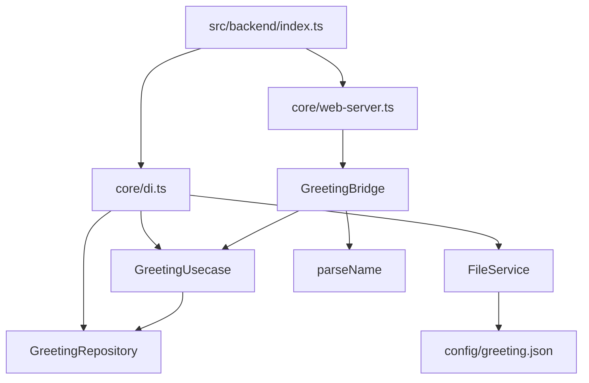
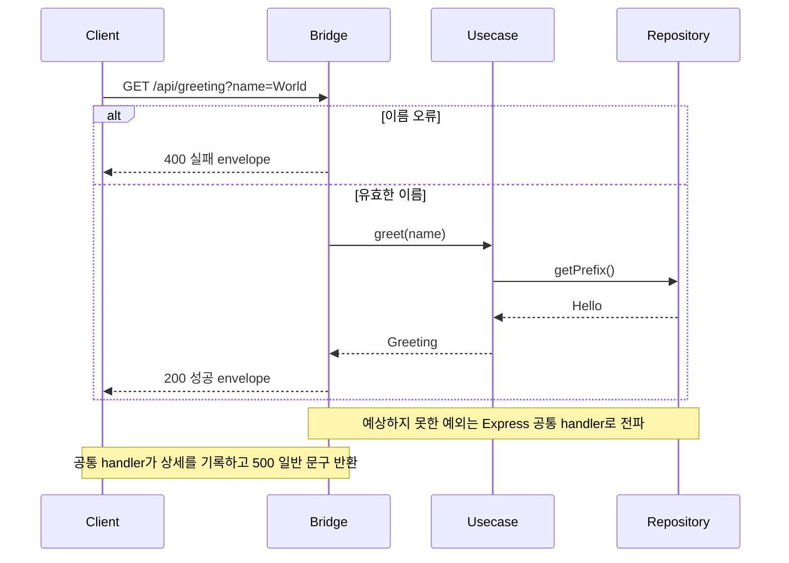

<!-- version: v2.1.0 -->
# TypeScript Server 구조·개발 규칙

## 1. 적용 범위

이름을 받아 인사말 JSON을 반환하는 읽기 전용 HTTP 서버입니다. server-wui backend의 구조를 사용하고 화면 제공 부분을 제거했습니다. electron-phaser의 IPC·Preload는 Electron 전송 통로에 해당하며 여기서는 Express Router가 전송 경계를 맡습니다. 원본 제품·다른 보일러플레이트 소스에 의존하지 않습니다.

| 역할 | electron-phaser backend | 이 server 샘플 |
| :--- | :--- | :--- |
| 진입·조립 | main.ts·MainRegistry | index.ts·core/di.ts |
| 전송 경계 | bridge의 ipcRenderer 호출·Usecase의 ipcMain handler 등록 | GreetingBridge의 Express Router |
| 기능 처리 | GreetingUsecase가 IPC 등록을 겸하고 Service를 호출 | HTTP와 분리한 GreetingUsecase·Repository |
| I/O·공유 기능 | services의 파일·인사 처리 | services의 파일 읽기·utils의 이름 검증 |

전송 기술이 달라 같은 인터페이스를 억지로 공유하지 않습니다. 큰 틀과 의존 방향을 맞추되 Electron의 발신자 검증과 HTTP query 검증은 각 경계에 남깁니다.

## 2. 기술 스택과 버전 기준

Node 24.22.1(.nvmrc), ESM·TypeScript 7.0.2, Express 5.2.1, tsx 4.23.12, Node 타입 24.19.2, Express 타입 5.0.6을 기존 server-wui와 맞췄습니다. 정확한 의존성은 npm이 생성한 package-lock.json, 앱 버전은 package.json의 1.0.0입니다. TypeScript는 ES2022·NodeNext로 빌드하고 로컬 import는 출력 파일 기준 .js 접미사를 씁니다. [Express 5](https://expressjs.com/en/5x/api/) · [TypeScript NodeNext](https://www.typescriptlang.org/docs/handbook/modules/reference.html#node16-nodenext).

## 3. 디렉터리·파일명·역할

아래는 프로젝트 루트 기준입니다. 폴더는 소문자 kebab-case, 타입은 PascalCase, 기능 파일은 기능명.bridge/usecase/model/repository/service/util.ts로 구분합니다.

| 파일 | 역할·연결 |
| :--- | :--- |
| README.md | 가져오기·시작·문서 입구 |
| project-agents.md | 새 앱용 작업 지침 보관본 |
| update.md | 실제 변경·검증·복귀 기록 |
| docs/01-getting-started.md | 도구 설치·버전 선택·실행·확인 |
| docs/02-boilerplate.md | 구조·파일·개발 규칙 |
| docs/03-build-and-release.md | 지원 OS·빌드·배포·보존·복귀 |
| .nvmrc | Node 24.22.1 선택 |
| .gitignore | 의존성·산출물·개인 환경 제외 |
| .env.example | 비밀값 없는 환경 양식; 기본 실행에는 값 불필요 |
| package.json | 앱 버전·정확한 직접 의존성·명령 |
| package-lock.json | npm 해석 의존성 고정 |
| tsconfig.json | src/backend·test/*.test.ts의 backend 타입 검사 |
| tsconfig.build.json | src/backend만 dist/backend로 컴파일 |
| scripts/copy-config.mjs | src/backend/config를 dist/backend/config로 복사 |
| src/backend/index.ts | 127.0.0.1:3101 수신·시작 오류·종료 신호 처리 |
| src/backend/core/web-server.ts | createApp, Router 연결·JSON 404·공통 500 |
| src/backend/core/di.ts | createDI, FileService→Repository→Usecase 조립; Bridge는 web-server에서 연결 |
| src/backend/bridge/greeting/greeting.bridge.ts | GreetingBridge, query 입력 검사·HTTP 응답 |
| src/backend/bridge/greeting/greeting.usecase.ts | GreetingUsecase, 검증한 이름·prefix로 결과 생성 |
| src/backend/bridge/greeting/greeting.model.ts | Greeting 결과 타입 |
| src/backend/repository/greeting/greeting.repository.ts | prefix 설정 검증·메모리 소유 |
| src/backend/services/file/file.service.ts | FileService, JSON 읽기·I/O 오류 전파 |
| src/backend/utils/greeting.util.ts | parseName, 문자열·trim·1~40자 검사 |
| src/backend/config/greeting.json | 공개 prefix 기본값 Hello |
| test/greeting.test.ts | HTTP 성공·400·404·500, 이름·설정·파일 오류 검사 |

## 4. 아키텍처·데이터 흐름

Node 프로세스가 HTTP 서버와 검증한 prefix를 소유합니다. core가 객체를 조립하고 Bridge→Usecase→Repository를 연결합니다. Repository는 부팅 때 FileService가 읽은 config를 검증하고 보관합니다. Service·Repository·Usecase는 Express를 import하지 않습니다. DB가 없는 이 샘플의 Repository는 데이터베이스 계층을 의미하지 않습니다.

입력은 단일 문자열만 받고 빈 값·공백·중복 query·40자 초과를 400으로 거부합니다. 없는 경로는 404 JSON, 내부 예외는 500 일반 문구이며 상세는 서버 로그에만 남습니다. 설정 누락·잘못된 JSON·잘못된 prefix는 부팅 실패이며 기본값으로 숨기지 않습니다. 진입점이 `createDI()` 결과를 `createApp(dependencies)`에 전달합니다. DI는 `greetingUsecase`를 반환하고 web-server가 이를 HTTP Bridge에 주입합니다. SIGINT·SIGTERM은 중복 종료를 막고 HTTP 수신을 닫습니다. 요청·화면 상태·IPC handler는 소유하지 않습니다.

## 5. 기능 작성 방식

1. 입출력·오류·보존할 데이터를 먼저 정합니다.
2. bridge/기능에 Model·Usecase·Bridge를 둡니다. 외부 입력은 Bridge에서 검증합니다.
3. I/O는 services, 실제 데이터 소유·조회는 필요한 Repository, 순수 처리는 utils로 분리합니다.
4. core/di.ts에서 Usecase까지 생성·주입하고 web-server.ts에서 Bridge 생성·경로 연결을 수행합니다. 전역 Registry·프레임워크 추상화는 추가하지 않습니다.
5. 정상·입력 오류·내부 실패 테스트와 빌드·실행을 확인하고 이 파일 목록·도식·update.md를 맞춥니다.

## 6. 설치·실행·검증

[시작 가이드](./01-getting-started.md)에서 Node를 준비한 루트에서 npm ci → npm run check → npm test → npm run build → npm start 순서로 진행합니다. npm run dev는 tsx watch, npm start는 dist/backend/index.js만 실행합니다. 소스 config를 바꾼 뒤 빌드 실행에는 재빌드가 필요합니다. 기본 포트 3101은 src/backend/index.ts에서 변경하며 충돌한 타 프로세스를 임의 종료하지 않습니다. 종료는 Ctrl+C입니다.

## 7. 보안·변경 경계

기본 수신은 loopback입니다. 인증·TLS·영구 쓰기·DB·CORS·프로세스 관리자·자동 배포가 구현되어 있지 않습니다. 원격 공개 전 운영 보안·권한·제한을 제품 요구에 맞게 추가합니다. 설정 파일은 공개 기본값만 담고 토큰·계정·개인 경로를 넣지 않습니다. JSON 구조 검증·입력 검증·500 상세 비노출을 이동·통합 시 유지합니다.

## 8. 독립 복사·프로젝트 이름

유형 폴더 하나를 새 이름으로 가져와 실행합니다. 다운로드·Git archive는 [README](../README.md#프로젝트-가져오기)를 따릅니다. 코드·docs·버전·lock·지침을 함께 내보내고 node_modules·dist·개인 .env·캐시는 제외합니다. npm 이름도 바꾸면 package.json의 name, lock 최상위 name·packages[""].name을 함께 맞춥니다. 앱·SDK·의존성 버전은 별도로 관리합니다.

## 9. 검증 결과와 요구사항 대조표

| 요구 | 확인 위치·방법 | 상태 |
| :--- | :--- | :--- |
| 독립 설치·타입·테스트·빌드 | package.json·lock·test, 임시 복사본 실행 | macOS 13.7.8 x64·Node 24.22.1에서 npm ci·check·테스트 3개·build 통과 |
| HTTP·설정·오류 경계 | greeting.test.ts·Bridge·Repository·FileService | 테스트로 확인 |
| 빌드 config 복사·시작·종료 | dist/backend/config·dist/backend/index.js, HTTP 호출·신호 종료 | 소스 없는 배포 복사본의 HTTP·포트 충돌·SIGINT/SIGTERM 종료 통과 |
| 문서·버전·지침·이력 | README·docs·project-agents·update | 파일·링크 대조 |
| Linux·Windows 운영 | 대상 OS·배포 환경 필요 | 미검증 |

실제 검증 OS·버전·명령과 한계는 [update.md](../update.md)에 기록합니다. 정적 검사·로컬 서버 검증을 외부 운영 배포 성공으로 표현하지 않습니다.
